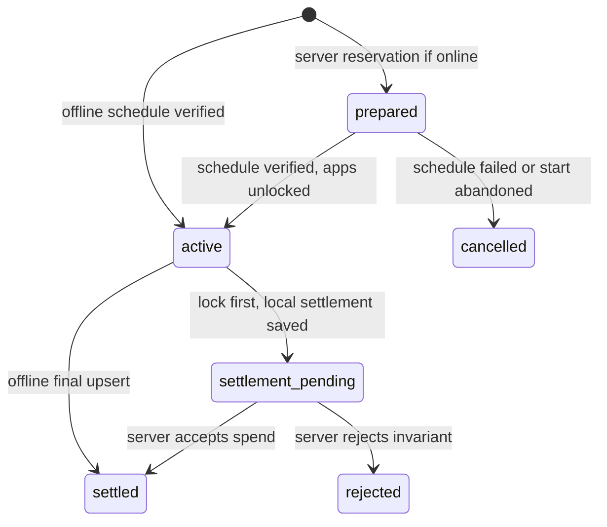
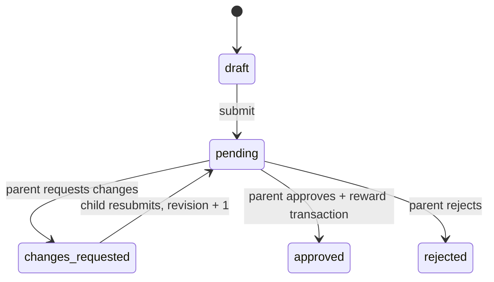

# PagePass MVP API Design

## Status

- 문서 상태: frontend IA 기반 MVP API 기준안
- 작성일: 2026-07-17
- 기준 문서: `docs/product/frontend-information-architecture.md`
- 대상: iOS Parent mode, iOS Child mode, Node API, PostgreSQL

이 문서는 화면을 구현하는 데 필요한 read model과 제품 규칙을 변경하는
command API를 함께 정의한다. OpenAPI와 `libs/shared`는 이 문서를 기준으로
구현하되, 실제 runtime schema가 최종 wire contract다.

문서 우선순위는 API wire contract에 대해서는 이 문서, 화면 책임은 frontend
IA, iOS Screen Time process boundary는 기존 MVP architecture 순서다. 기존
architecture에 남아 있는 reading timer/reward ratio는 새 IA에 대응 화면이 없으므로
이번 MVP API에 포함하지 않는다. Parent가 submission 승인 시 reward seconds를
선택하며, 독서 타이머가 제품에 다시 확정될 때 별도 resource로 추가한다.

## Non-Negotiable Boundaries

1. Parent는 PagePass account session으로 family 범위의 데이터를 관리한다.
2. Child installation은 로그인하지 않고 한 child profile과 active device에
   제한된 device credential을 사용한다.
3. 서버는 앱을 직접 잠그지 않는다. child device가 Family Controls,
   Managed Settings와 Device Activity를 실행한다.
4. 서버는 policy와 canonical ledger의 source of truth다. child device는
   enforcement를 위한 last-synced snapshot과 offline outbox를 가진다.
5. Earned Time은 앱별 사용량이 아니라 child가 명시적으로 시작한 wall-clock
   session으로 차감한다.
6. OCR은 필수지만 on-device Vision 결과다. Parent review가 승인과 reward의
   최종 권한을 가진다.
7. application token은 child picker에서 생성된 opaque data다. 서버는 이를
   해석하거나 앱 목록을 직접 수집하지 않는다.
8. credit, review, app policy decision과 session settlement는 모두 audit 가능하고
   idempotent해야 한다.

## API Shape

Base path는 `/v1`이고 모든 timestamp는 UTC ISO 8601, duration과 balance는 정수
seconds를 사용한다. 모든 ID는 client가 의미를 추측할 수 없는 UUID다.

인증:

```text
Parent API  Authorization: Bearer <parent-session-token>
Child API   Authorization: Bearer <device-credential>
Pairing     unauthenticated, short-lived secret + strict rate limit
```

Parent session은 family membership을, device credential은 `child_profile_id`와
`device_id`를 서버에서 결정한다. Child request body에서 ownership ID를 받지
않는다.

목록 응답은 다음 cursor 규칙을 사용한다.

```json
{
  "items": [],
  "nextCursor": null
}
```

변경 가능한 resource는 `version`을 반환한다. 기존 상태를 전제로 하는 command는
`expectedVersion`을 보내며 불일치 시 `409 version_conflict`와 최신 resource를
받는다.

네트워크 재시도가 가능한 command는 client가 operation 생성 전에 저장한
`idempotencyKey`를 body에 포함한다. 같은 key와 같은 payload는 기존 결과를
반환하고, 같은 key의 다른 payload는 `409 idempotency_conflict`다.

## Error Contract

```json
{
  "error": {
    "code": "invalid_transition",
    "message": "This report is no longer waiting for review.",
    "retryable": false,
    "requestId": "req_...",
    "details": {}
  }
}
```

주요 오류:

| HTTP | Code | 의미 |
| --- | --- | --- |
| 400 | `invalid_request` | JSON 또는 field 형식 오류 |
| 401 | `invalid_session` | parent session/device credential 만료 또는 폐기 |
| 403 | `forbidden_scope` | 다른 family/child resource 접근 |
| 404 | `not_found` | resource 없음 또는 접근 범위 밖 |
| 409 | `version_conflict` | optimistic concurrency 충돌 |
| 409 | `idempotency_conflict` | 같은 key로 다른 operation 요청 |
| 409 | `invalid_transition` | 현재 상태에서 command 실행 불가 |
| 409 | `active_session_exists` | 정산되지 않은 session 존재 |
| 409 | `pairing_conflict` | active/pending device 규칙 위반 |
| 410 | `pairing_expired` | pairing code 만료 또는 사용 완료 |
| 422 | `settlement_rejected` | 시간/잔액/session invariant 위반 |
| 429 | `rate_limited` | pairing/auth attempt 제한 |
| 503 | `temporarily_unavailable` | 일시적인 server dependency 장애 |

Apple authorization 오류는 child device에서 발생한다. Child는 이를 정규화한
device status로 서버에 보고하며 framework 원문을 Parent UI에 노출하지 않는다.

## Core Resources

### Family And Identity

```text
ParentAccount
Family
FamilyMember(role: owner | parent)
ChildProfile(status: active | archived)
Device(status: pending_setup | active | retired | revoked)
PairingSession(purpose: add_device | replace_device)
```

MVP도 `Family`를 명시적으로 둔다. 현재 DB의 `children.owner_parent_id`만으로는
family 복원, 여러 child, 향후 두 번째 parent를 안전하게 표현할 수 없다. Parent
member UI가 후순위여도 membership boundary는 처음부터 family로 잡는다.

### Device Setup

서버가 저장하는 정규화 상태:

```text
setupStatus:
  pairing_required
  authorization_required
  authorization_conflict
  app_selection_required
  locking_verification
  ready

authorizationStatus:
  not_determined
  approved
  denied
  conflict
  restricted
  revoked
  unavailable

shieldStatus:
  unknown
  locked
  unlocked_for_session
  verification_failed
```

`ready`는 active/pending device가 `approved` authorization, 하나 이상의 managed
app selection, zero-credit Shield readback을 모두 보고한 경우에만 서버가
계산한다. Client가 임의로 `setupStatus=ready`를 전송하지 않는다.

### App Access

```text
ManagedApp
  id
  childProfileId
  sourceDeviceId
  tokenEnvelope
  tokenFormatVersion
  policy: blocked | earned_time | always_allowed
  policyVersion
  archivedAt

AppRequest
  id
  managedAppId
  message
  status: pending | decided
  requestedAt
  decision
  decidedBy
  decidedAt
```

초기 picker selection은 각 앱을 `blocked`로 등록하고 즉시 잠근다. 초기 등록
자체는 Parent Requests inbox를 앱 수만큼 채우지 않는다. Child가 특정 앱을
요청할 때만 `AppRequest(pending)`를 만든다. Parent는 request가 없어도 Child
Detail의 App Access에서 이미 알려진 앱을 언제든 재분류할 수 있다.

`Rejected`는 앱 policy가 아니다. 요청 decision일 뿐이며 현재 policy는 유지한다.
동일 managed app에 pending request는 하나만 존재한다. 한 번 등록된 앱은 device
token이 유효한 동안 Parent App Access에 계속 보인다.

새로 설치됐지만 picker에서 아직 등록되지 않은 앱은 서버가 알 수 없고 policy,
잠금 또는 Earned Time 차감 대상이 아니다. `setupStatus=ready`는 선택된 managed
app 집합의 lock proof이지 기기 전체 앱을 열거했다는 증명이 아니다. MVP는
parent-supervised initial selection과 child app request로 이 범위를 관리하며,
공개 API가 제공하지 않는 background app enumeration을 가정하지 않는다.

`tokenEnvelope`는:

- child picker가 생성하고 versioned Codable envelope로 전송한다.
- 로그, analytics, error payload에 기록하지 않는다.
- DB에서 application-level encryption을 적용한다.
- 권한 있는 Parent/해당 Child에게만 반환한다.
- 서버에서 app name/icon으로 변환하지 않는다.
- device 교체 또는 authorization revoke 시 archive하고 새 device에서 다시
  선택한다.

### Credit Ledger

하나의 append-only ledger로 표현한다.

```text
CreditLedgerEntry
  type: parent_grant | reading_reward | session_spend | parent_adjustment
  amountSeconds: signed integer
  sourceId
  actor
  reason
  idempotencyKey
  createdAt
```

```text
canonicalBalanceSeconds = sum(amountSeconds)
```

API는 음수 balance를 만드는 entry를 허용하지 않는다. `balance` row를 직접
수정하지 않고 transaction 안에서 ledger append와 새 balance/revision 계산을
완료한다.

Active session이 있을 때는 두 값을 구분한다.

```text
canonicalBalanceSeconds = 아직 settlement되지 않은 원장 잔액
spendableBalanceSeconds = canonical balance - prepared/active reserved duration
```

Child는 offline session을 시작할 수 있으므로 local UI에서는 last-synced canonical
balance에서 local reservation을 뺀 값을 사용한다. Parent의 active session은
마지막으로 보고된 정보이며 실시간 보장으로 표시하지 않는다.

### Earned Time Session

```text
EarnedTimeSession
  localSessionId
  childProfileId
  deviceId
  requestedDurationSeconds
  balanceBeforeSeconds
  startedAt
  expiresAt
  endedAt
  consumedSeconds
  endReason: manual_stop | expired | recovery
  state: prepared | active | settlement_pending | settled | cancelled | rejected
  settlementIdempotencyKey
  lastSyncedAt
```

State transition:



Server upsert의 request `phase`는 `prepared | active | final | cancelled`다. Online
start는 먼저 `prepared`로 duration을 예약하고 schedule 검증 후 `active`를
보고한다. Schedule 등록 실패 또는 시작 포기는 `cancelled`로 reservation을
회수한다. Offline으로 시작한 device는 prepared/active upload 없이 final만 올릴
수 있다. `localSessionId`, start와 requested duration은 최초 기록 후 변경할 수
없다.

Start/stop correctness는 다음 순서를 지킨다.

```text
Start: local intent -> server prepared upsert if online -> DeviceActivity schedule
       verification -> local active -> Shield 해제 -> server active upsert

Stop:  Shield 재적용 -> schedule 취소 -> local settlement/outbox 저장
       -> local balance 반영 -> server final upsert
```

서버 prepared upsert 실패만으로 이미 검증된 offline balance의 시작을 막지
않는다. Schedule 검증 실패는 항상 잠금 유지이며 online reservation도
cancel한다. Client가 cancel하지 못한 stale prepared session은 `expiresAt` 이후
서버 reconciliation이 spend 없이 cancel한다. Active sync upload는 unlock의
gate가 아니다. Push 또는 서버 timer는 만료 재잠금의 correctness
path가 아니다.

### Reading Submission

```text
ReadingSubmission
  id
  childProfileId
  revision
  status: draft | pending | changes_requested | approved | rejected
  processingStatus: idle | processing | failed
  bookTitle
  author
  coverMediaId
  reportBody
  ocrText
  createdAt
  submittedAt
  reviewedAt

ReadingEvidence
  id
  submissionId
  originalMediaId
  thumbnailMediaId
  pageOrder
  uploadStatus

SubmissionReview
  id
  submissionId
  revision
  decision: approved | changes_requested | rejected
  comment
  rewardSeconds
  actorParentId
  createdAt
```

OCR은 child device에서 실행한다. 원본 이미지, OCR text와 child report를 각각
보존하고 Parent detail에서 함께 제공한다. OCR 실패 후 retry하거나 OCR text를
검토해도 이미 저장한 report draft를 잃지 않는다.

Reading state transition:



OCR와 media upload 진행은 review workflow와 직교한다. API의
`processingStatus`와 local OCR state로 Child Journal의 `Processing` display status를
만들고, 완료 또는 실패해도 submission workflow는 `draft`에 남는다.

`approved`와 `rejected`는 terminal이다. Rejected report를 다시 작업하면
`supersedesSubmissionId`를 가진 새 draft를 만든다. Approval과 positive reward
ledger entry는 하나의 DB transaction이며 하나의 idempotency key를 공유한다.

## Read Aggregates

Read aggregate는 UI가 여러 endpoint를 조합하며 서로 다른 revision을 보여주는
문제를 줄인다. Detail과 긴 history는 별도 pagination endpoint로 분리한다.

### Parent Home

`GET /v1/parent/home`

```json
{
  "family": { "id": "...", "name": "Choi Family" },
  "summary": {
    "pendingRequestCount": 2,
    "devicesNeedingAttentionCount": 1
  },
  "children": [
    {
      "id": "...",
      "name": "Atom",
      "profileImageUrl": null,
      "canonicalBalanceSeconds": 7200,
      "spendableBalanceSeconds": 6300,
      "controlStatus": "active",
      "activeSession": {
        "startedAt": "2026-07-17T20:00:00Z",
        "expiresAt": "2026-07-17T20:15:00Z",
        "reportedAt": "2026-07-17T20:01:00Z"
      },
      "pendingRequestCount": 1,
      "setupStatus": "ready",
      "deviceStatus": "online",
      "lastSyncedAt": "2026-07-17T20:01:00Z"
    }
  ],
  "serverTime": "2026-07-17T20:01:05Z"
}
```

`controlStatus`는 `locked | active | offline | action_required`다. Countdown은
`serverTime`과 `expiresAt`으로 client가 표시하고 `reportedAt`을 함께 보여 실제
remote observation처럼 오해하지 않게 한다.

### Parent Child Detail

`GET /v1/parent/children/:childId`

Overview, policy summary, journal summary, device summary와 최근 ledger 10개를
반환한다. 전체 app 목록, journal과 ledger는 다음 전용 endpoint로 pagination한다.

### Child Snapshot

`GET /v1/child/snapshot`

기존 endpoint를 Child Home과 foreground reconciliation의 단일 sync contract로
확장한다.

```json
{
  "childProfile": { "id": "...", "name": "Atom" },
  "canonicalBalanceSeconds": 7200,
  "spendableBalanceSeconds": 7200,
  "ledgerRevision": 18,
  "policy": {
    "version": 7,
    "items": [],
    "summary": {
      "earnedTimeCount": 3,
      "alwaysAllowedCount": 2,
      "blockedCount": 5
    }
  },
  "serverActiveSession": null,
  "setup": {
    "status": "ready",
    "authorizationStatus": "approved",
    "shieldStatus": "locked",
    "nextAction": null
  },
  "pendingSettlementCount": 0,
  "latestUpdate": null,
  "serverTime": "2026-07-17T20:01:05Z",
  "lastSyncedAt": "2026-07-17T20:01:05Z"
}
```

API는 child가 보내는 `pendingSettlementCount`를 device status에 저장해 다시
반환할 수 있지만, 서버가 아직 받지 못한 settlement의 금액을 추측하지 않는다.

### Unified Parent Requests

`GET /v1/parent/requests?status=pending&type=all&childId=&cursor=`

응답 item은 discriminated union이다.

```text
type=reading  -> submission summary, current revision, allowed decisions
type=app      -> managed app token envelope, message, existing policy
```

이 endpoint는 inbox read model일 뿐이다. Decision command는 reading과 app의
서로 다른 invariant를 지키기 위해 typed endpoint를 사용한다.

### Journal

```text
GET /v1/parent/submissions?childId=&status=&query=&cursor=
GET /v1/parent/submissions/:submissionId
GET /v1/child/submissions?status=&cursor=
GET /v1/child/submissions/:submissionId
```

Parent list는 family의 모든 child를 지원하고, Child list는 credential scope의
profile만 반환한다. Detail의 media URL은 짧게 만료되는 signed read URL이다.

## Command And Resource Endpoints

### Authentication And Family

| Method | Path | Purpose |
| --- | --- | --- |
| POST | `/v1/auth/apple/challenges` | Sign in with Apple nonce/state 생성 |
| POST | `/v1/auth/apple/sessions` | Apple token 검증 후 Parent session 생성 |
| DELETE | `/v1/auth/session` | 현재 Parent session 폐기 |
| GET | `/v1/parent/me` | account, family membership 반환 |
| GET | `/v1/parent/home` | multi-child dashboard aggregate |
| PUT | `/v1/parent/device` | Parent installation metadata와 APNs token upsert |
| GET | `/v1/parent/family/preferences` | family product preference 읽기 |
| PATCH | `/v1/parent/family/preferences` | reward/session/app request 기본값 변경 |
| GET | `/v1/parent/preferences` | 현재 Parent notification preference |
| PATCH | `/v1/parent/preferences` | 현재 Parent notification preference 변경 |
| GET | `/v1/parent/children` | child 관리 목록 |
| POST | `/v1/parent/children` | child profile 생성 |
| GET | `/v1/parent/children/:childId` | child detail aggregate |
| PATCH | `/v1/parent/children/:childId` | 이름/profile/timezone 수정 |
| POST | `/v1/parent/children/:childId/archive` | history를 보존하며 archive |

Parent account가 처음 로그인하고 family가 없으면 session 생성 transaction에서
기본 family를 만든다. 별도 `create family` onboarding round trip은 필요 없다.
Family preference는 versioned resource이며 기본 reading reward, 허용 session
preset, expiration warning과 app request behavior를 담는다. 확정되지 않은 제품
결정은 server default로 시작하고 field 추가로 확장한다.

### Pairing And Device

| Method | Path | Purpose |
| --- | --- | --- |
| POST | `/v1/parent/children/:childId/pairing-sessions` | QR/code 생성, purpose 포함 |
| POST | `/v1/pairing/consume` | code 사용, pending device credential 발급 |
| GET | `/v1/parent/children/:childId/devices` | active/past device history |
| GET | `/v1/parent/children/:childId/devices/:deviceId` | device/setup detail |
| PUT | `/v1/child/device-status` | authorization, Shield, version, last seen 보고 |
| PUT | `/v1/child/push-token` | APNs token rotate/clear |
| POST | `/v1/parent/children/:childId/devices/:deviceId/revoke` | device credential 폐기 |

Device status body는 `observedAt`, `appVersion`, `appBuild`,
`authorizationStatus`, `managedAppCount`, `shieldStatus`,
`lastAppliedPolicyVersion`, `lockVerification`, `pendingSettlementCount`를
포함한다. `lockVerification`은 `result`, 검증한 policy version과 `verifiedAt`을
가지며 서버는 이 보고와 device lifecycle로 setup 상태를 계산한다.

Pairing body:

```json
{
  "purpose": "add_device"
}
```

새 pairing session 생성은 같은 child/purpose의 이전 미사용 session을 즉시
invalidate한다. 따라서 response가 유실된 retry는 새 secret을 만들며 서버가
원문 QR secret을 재응답 목적으로 보관할 필요가 없다.

QR와 6자리 code는 같은 5분짜리 one-time session을 가리킨다. QR payload에는
고엔트로피 opaque token만 포함하고, 숫자 code consume은 installation, network와
pairing session 기준으로 rate limit한다.

Replacement pairing은 새 device를 `pending_setup`으로 연결한다. 기존 active
device는 새 device의 lock verification 성공 전까지 유지한다. 새 device가
`ready`가 되는 transaction에서 새 device를 active로 만들고 기존 device
credential을 revoke한다. Pending replacement device는 setup/sync만 가능하고
Earned Time start/settlement는 할 수 없다.

### Credit And Time History

| Method | Path | Purpose |
| --- | --- | --- |
| POST | `/v1/parent/children/:childId/credit-grants` | Parent Add Time |
| POST | `/v1/parent/children/:childId/credit-adjustments` | 이유가 필수인 signed adjustment |
| GET | `/v1/parent/children/:childId/ledger?cursor=` | Time History |
| GET | `/v1/child/ledger?cursor=` | 자신의 recent earned/spent history |

`credit-grants`는 양수만 허용한다. Adjustment는 launch 전 별도 권한과 UX가
확정될 때까지 API를 feature flag 뒤에 둔다. 모든 응답은 생성 entry와
`canonicalBalanceSeconds`, `ledgerRevision`을 함께 반환한다.

### App Selection, Requests And Policy

| Method | Path | Purpose |
| --- | --- | --- |
| POST | `/v1/child/managed-apps` | 초기 또는 추가 picker selection batch 등록 |
| GET | `/v1/child/app-access` | 현재 policy와 pending request 확인 |
| POST | `/v1/child/app-requests` | 알려진 managed app에 Parent decision 요청 |
| GET | `/v1/parent/children/:childId/app-access` | 네 policy group과 request history |
| PUT | `/v1/parent/children/:childId/app-policies/:managedAppId` | request 없이 policy 재분류 |
| POST | `/v1/parent/app-requests/:requestId/decision` | pending request 결정 |
| POST | `/v1/child/policy-acks` | policy version 적용/readback 결과 보고 |

Register는 `clientAppId`, token envelope와 token format version의 배열을 받고
동일 device/token fingerprint를 dedupe한다. 등록되지 않은 앱은 서버에서 policy
대상이 될 수 없고, 해당 앱 사용을 Earned Time으로 계산하지도 않는다.

Policy decision body:

```json
{
  "policy": "earned_time",
  "expectedPolicyVersion": 7,
  "expectedRequestVersion": 2,
  "idempotencyKey": "..."
}
```

Decision transaction은 managed app policy, child policy version, request status와
audit log를 함께 갱신한다. Child snapshot은 새 policy version 전체를 반환한다.
Child는 적용 후 ack하고, 적용 실패 시 fail closed 상태와 normalized reason을
보고한다. Request 없이 직접 policy를 바꾸는 endpoint는
`expectedRequestVersion`을 받지 않는다. Ack는 `policyVersion`,
`result=applied|failed`, `appliedAt`과 normalized failure reason을 포함한다.

### Earned Time Sessions

| Method | Path | Purpose |
| --- | --- | --- |
| PUT | `/v1/child/earned-time-sessions/:localSessionId` | prepared/active/final/cancelled idempotent upsert |

Active payload:

```json
{
  "phase": "prepared",
  "requestedDurationSeconds": 1800,
  "balanceBeforeSeconds": 7200,
  "startedAt": "2026-07-17T20:00:00Z",
  "expiresAt": "2026-07-17T20:30:00Z"
}
```

Schedule 검증 후 같은 immutable fields와 `phase=active`를 upsert한다. Final
payload는 `phase=final`, `endedAt`, `consumedSeconds`, `endReason`과
`settlementIdempotencyKey`를 추가한다.
기존 settlement invariant에 더해 서버는 active device, 한 개의 unsettled
session, immutable start/duration, ledger balance와 clock skew를 검증한다.
Prepared 이후 schedule이 실패하면 `phase=cancelled`를 보내며 spend ledger는
생성하지 않는다.

이 endpoint의 전체 session identity와 PUT retry 멱등성은 path의
`localSessionId`가 담당한다. 같은 phase/payload retry는 현재 resource를 반환하고
immutable field 변경은 `409`다. Final ledger append는
`settlementIdempotencyKey`와 `source=session/localSessionId` unique constraint로
추가 보호한다.

`requestedDurationSeconds`는 900초 이상이고 synced spendable balance 이하여야
한다. `Max`도 별도 무제한 mode가 아니라 client가 현재 spendable seconds를
정확한 duration으로 보내는 같은 session이다.

자연 만료는 `consumedSeconds=requestedDurationSeconds`다. Manual stop은
`ceil(endedAt-startedAt)`을 duration 이하로 cap한다. Server가 client 계산과 다른
값을 허용하지 않고 expected consumed seconds를 오류 detail에 반환한다.

### Reading Draft, Media, OCR And Review

| Method | Path | Purpose |
| --- | --- | --- |
| POST | `/v1/child/submissions` | cloud draft 생성 |
| PATCH | `/v1/child/submissions/:submissionId` | book/report/OCR autosave |
| POST | `/v1/child/submissions/:submissionId/media-uploads` | image upload intent 생성 |
| POST | `/v1/child/submissions/:submissionId/media-uploads/:uploadId/complete` | checksum 검증 후 evidence 연결 |
| DELETE | `/v1/child/submissions/:submissionId/evidence/:evidenceId` | draft evidence 제거 |
| POST | `/v1/child/submissions/:submissionId/submit` | pending으로 전환 |
| POST | `/v1/child/submissions/:submissionId/resubmit` | changes requested revision 제출 |
| DELETE | `/v1/child/submissions/:submissionId` | draft만 삭제 |
| POST | `/v1/parent/submissions/:submissionId/reviews` | approve/change/reject command |

`PATCH`는 child가 마지막으로 읽은 `expectedVersion`을 포함하며 field mask 대신
명시적인 nullable/optional draft fields를 schema로 제한한다. Pending 이후에는
수정할 수 없다.

Media upload는 원본 byte를 API process와 PostgreSQL에 넣지 않는다. API가
short-lived upload URL과 `mediaId`를 발급하고 object storage upload 완료 후
SHA-256, content type, byte size를 검증한다. Local development는 S3-compatible
container를 붙일 수 있지만 resource contract는 동일하게 유지한다.

Review body:

```json
{
  "decision": "approved",
  "comment": "Great summary.",
  "rewardSeconds": 1800,
  "expectedSubmissionVersion": 4,
  "idempotencyKey": "..."
}
```

`approved`는 `rewardSeconds > 0`이 필수다. `changes_requested`와 `rejected`는
comment가 필수이고 reward는 0이어야 한다. Response는 review, submission,
ledger entry와 새 balance를 한 번에 반환한다.

## Notification Contract

Push payload에는 화면 데이터 전체가 아니라 sync와 deep link에 필요한 최소
정보만 넣는다.

```json
{
  "eventId": "...",
  "eventType": "reading.approved",
  "resourceId": "...",
  "childProfileId": "...",
  "route": "pagepass://child/journal/...",
  "revision": 19
}
```

Event ID로 client notification 처리를 dedupe한다. Push 수신 여부는 policy 적용,
session expiry 또는 re-lock의 correctness에 관여하지 않는다. App foreground,
manual retry와 periodic background opportunity가 snapshot sync를 수행한다.

## Offline And Conflict Rules

| Flow | Offline behavior |
| --- | --- |
| Parent decision/add time | 로컬 성공으로 표시하지 않고 idempotent retry |
| Child draft | 로컬 저장 후 versioned autosave retry |
| Image upload/OCR | OCR/report는 보존하고 upload만 retry |
| App request | local pending 표시 후 idempotent retry, 앱은 잠금 유지 |
| Policy sync | 마지막 적용 version 유지, 불확실하면 fail closed |
| Earned Time start | synced spendable balance 범위에서 허용 |
| Manual stop/expiry | 먼저 잠그고 local immutable settlement/outbox 저장 |
| Settlement rejection | 잠금 유지, snapshot refetch, 자동 credit 복원 금지 |

Client clock은 countdown display와 local schedule에 필요하지만 ledger authority는
아니다. 서버는 `serverTime`, 허용 clock skew와 session timestamp invariant를
사용한다. Device가 clock을 크게 변경하면 새 session 시작을 막고 sync/action
banner를 표시한다.

## Authorization Matrix

| Resource/Command | Parent | Active Child | Pending Replacement |
| --- | --- | --- | --- |
| Family/children read | family scope | own profile only | own profile setup only |
| Add credit/review | yes | no | no |
| Change app policy | yes | no | no |
| Register app tokens | no | own device | own pending device |
| App request | read/decide | create own | no |
| Start/settle session | read reported status | yes | no |
| Device status/ack | read | write own | write own setup |
| Journal | family read/review | own read/write | own restored read only |
| Archive/revoke/replace | yes | no | no |

Repository query마다 parent ID 하나가 아니라 authenticated family ID를 조건에
포함한다. 존재하지만 scope 밖인 resource도 `404`로 응답해 ID enumeration을
막는다.

## PostgreSQL Model Changes

전체 target schema와 관계는 ERD Editor에서 열 수 있는
[`pagepass-mvp.erd`](pagepass-mvp.erd)를 기준으로 한다. 이 파일이 직접 관리하는
설계 원본이다.

현재 배포 가능한 데이터베이스 상태와 변경 이력은
`../../apps/api/prisma/schema.prisma`와 `../../apps/api/prisma/migrations`가
관리한다. ERD의 목표 모델은 기능 구현 순서에 맞춰 Prisma migration으로
점진적으로 반영한다.

현재 PostgreSQL은 auth, children, active device, pairing, grant와 final spend proof만
구현한다. Frontend IA 전체를 지원하려면 다음 table이 필요하다.

```text
families
family_members
family_preferences
parent_preferences
child_profiles (기존 children 확장/이관)
devices (기존 active_devices를 history model로 교체)
pairing_sessions (purpose, device lifecycle fields 확장)
device_status_reports
managed_apps
app_requests
child_policy_versions
app_policy_changes
policy_application_acks
credit_ledger_entries (기존 grants/spends 통합 view 또는 이관)
earned_time_sessions (active + final state)
reading_submissions
reading_evidence
submission_reviews
media_objects
audit_events
notification_outbox
```

핵심 DB constraint:

- child profile당 active device 하나인 partial unique index
- child profile당 unsettled Earned Time session 하나인 partial unique index
- child/app당 pending app request 하나인 partial unique index
- submission revision의 monotonic unique constraint
- review idempotency key와 승인 reward source의 unique constraint
- ledger row UPDATE/DELETE 금지 trigger
- ledger `source_type + source_id` unique constraint
- policy version child별 unique 및 증가 transaction
- pairing secret hash unique, expiry와 consumed state 검증

## Current API Gap And Migration Order

| Existing surface | Decision |
| --- | --- |
| Apple challenge/session | 유지, family bootstrap 추가 |
| `GET /v1/parent/me` | family membership 포함하도록 확장 |
| children list/create | 유지, family scope와 detail aggregate 추가 |
| pairing create/consume | 유지, purpose와 pending replacement lifecycle 추가 |
| credit grants | 유지, unified ledger와 audit에 연결 |
| `GET /v1/child/snapshot` | Child Home/policy/setup aggregate로 확장 |
| earned-time session PUT | final-only에서 prepared/active/final/cancelled union으로 확장 |
| app policy/request | 신규 |
| reading/OCR/media/review | 신규 |
| notifications | core loop 뒤에 outbox 기반으로 신규 |

구현 순서:

1. Family/device history schema와 Home/Child snapshot read model
2. Managed app registration, Parent policy decision, versioned child sync/ack
3. Active/final Earned Time session과 unified ledger
4. Reading cloud draft, media upload와 on-device OCR payload
5. Parent unified Requests, atomic review + reward, Journal
6. Device replacement commit와 archive/revoke
7. Notification outbox, APNs와 preferences

각 단계는 기존 physical-device Screen Time proof를 다시 구현하지 않는다. Native
enforcement service는 유지하고 API 계약과 sync adapter만 교체한다.

## Deferred From MVP API

- AI report scoring 또는 auto approval
- web dashboard
- Android child enforcement
- child profile당 동시 active device 여러 개
- full-device lock/MDM
- realtime socket presence
- server-side app catalog crawling
- Screen Time private API 또는 Settings private URL scheme
- subscription billing contract
- Parent member 초대 UI와 세부 role permission

Parent member 기능을 나중에 추가해도 `FamilyMember` boundary와 audit actor는 지금
유지한다. Open product decision은 endpoint shape를 깨지 않고 preference 또는
policy field로 확장한다.
