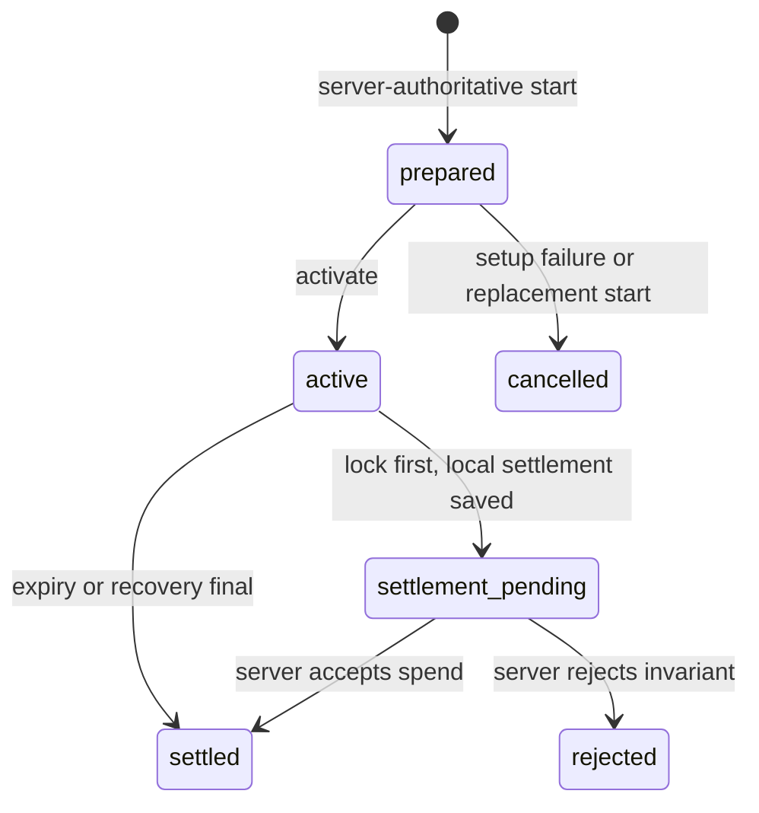
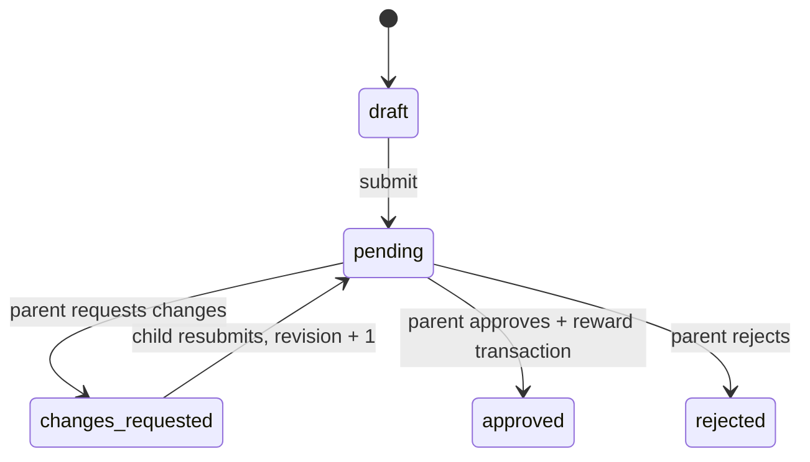

# PagePass MVP API Design

## Status

- 문서 상태: frontend IA 기반 MVP API 기준안
- 작성일: 2026-07-17
- 기준 문서: `docs/product/frontend-information-architecture.md`
- 대상: iOS Parent mode, iOS Child mode, Node API, PostgreSQL

이 문서는 화면을 구현하는 데 필요한 read model과 제품 규칙을 변경하는
command API를 함께 정의한다. OpenAPI와 `libs/shared`는 이 문서를 기준으로
구현하되, 실제 runtime schema가 최종 wire contract다.

문서 우선순위는 API wire contract에 대해서는 이 문서, 화면 책임은 frontend
IA, iOS Screen Time process boundary는 기존 MVP architecture 순서다. 기존
architecture에 남아 있는 reading timer/reward ratio는 새 IA에 대응 화면이 없으므로
이번 MVP API에 포함하지 않는다. Parent가 submission 승인 시 reward seconds를
선택하며, 독서 타이머가 제품에 다시 확정될 때 별도 resource로 추가한다.

## Non-Negotiable Boundaries

1. Parent는 Better Auth session으로 family 범위의 데이터를 관리한다.
2. Child installation은 로그인하지 않고 한 child profile과 active device에
   제한된 device credential을 사용한다.
3. 서버는 앱을 직접 잠그지 않는다. child device가 Family Controls,
   Managed Settings와 Device Activity를 실행한다.
4. 서버는 policy와 canonical ledger의 source of truth다. child device는
   enforcement를 위한 last-synced snapshot과 offline outbox를 가진다.
5. Earned Time은 앱별 사용량이 아니라 child가 명시적으로 시작한 wall-clock
   session으로 차감한다.
6. OCR 시도는 필수이고 child device의 on-device Vision 결과다. 대상은 책 본문이
   아니라 자녀가 종이에 쓴 손글씨 독후감이다. 원본 이미지가 source of truth이고
   Parent review가 승인과 reward의 최종 권한을 가진다.
7. application token은 child picker에서 생성된 opaque data다. 서버는 이를
   해석하거나 앱 목록을 직접 수집하지 않는다.
8. credit, review, app policy decision과 session settlement는 모두 audit 가능하고
   idempotent해야 한다.

## API Shape

Base path는 `/v1`이고 모든 timestamp는 UTC ISO 8601, duration과 balance는 정수
seconds를 사용한다. PagePass domain ID는 client가 의미를 추측할 수 없는 UUID고,
Better Auth가 소유하는 User/session/account ID는 opaque text다.

인증:

```text
Parent API  Authorization: Bearer <parent-session-token>
Child API   Authorization: Bearer <device-credential>
Pairing     unauthenticated, short-lived secret + strict rate limit
```

Better Auth session의 User ID는 family membership을, device credential은
`child_profile_id`와 `device_id`를 서버에서 결정한다. Child request body에서
ownership ID를 받지 않는다. Better Auth는 Parent identity에만 사용하며 Child
installation credential과 Screen Time authorization을 대신하지 않는다.

목록 응답은 다음 cursor 규칙을 사용한다.

```json
{
  "items": [],
  "nextCursor": null
}
```

변경 가능한 resource는 `version`을 반환한다. 기존 상태를 전제로 하는 command는
`expectedVersion`을 보내며 불일치 시 `409 version_conflict`와 최신 resource를
받는다.

네트워크 재시도가 가능한 command는 client가 operation 생성 전에 저장한
`idempotencyKey`를 body에 포함한다. 같은 key와 같은 payload는 기존 결과를
반환하고, 같은 key의 다른 payload는 `409 idempotency_conflict`다.

## Error Contract

```json
{
  "error": {
    "code": "invalid_transition",
    "message": "This report is no longer waiting for review.",
    "retryable": false,
    "requestId": "req_...",
    "details": {}
  }
}
```

주요 오류:

| HTTP | Code | 의미 |
| --- | --- | --- |
| 400 | `invalid_request` | JSON 또는 field 형식 오류 |
| 401 | `invalid_session` | parent session/device credential 만료 또는 폐기 |
| 403 | `forbidden_scope` | 다른 family/child resource 접근 |
| 404 | `not_found` | resource 없음 또는 접근 범위 밖 |
| 409 | `version_conflict` | optimistic concurrency 충돌 |
| 409 | `idempotency_conflict` | 같은 key로 다른 operation 요청 |
| 409 | `invalid_transition` | 현재 상태에서 command 실행 불가 |
| 409 | `active_session_exists` | 정산되지 않은 session 존재 |
| 409 | `pairing_conflict` | active/pending device 규칙 위반 |
| 410 | `pairing_expired` | pairing code 만료 또는 사용 완료 |
| 422 | `settlement_rejected` | 시간/잔액/session invariant 위반 |
| 429 | `rate_limited` | pairing/auth attempt 제한 |
| 503 | `temporarily_unavailable` | 일시적인 server dependency 장애 |

Apple authorization 오류는 child device에서 발생한다. Child는 이를 정규화한
device status로 서버에 보고하며 framework 원문을 Parent UI에 노출하지 않는다.

## Core Resources

### Family And Identity

```text
User (Better Auth)
Session (Better Auth)
Account (Better Auth)
Verification (Better Auth)
Family
FamilyMember(role: owner | parent)
ChildProfile(status: active | archived)
Device(status: pending_setup | active | retired | revoked)
PairingSession(purpose: add_device | replace_device)
```

MVP도 `Family`를 명시적으로 둔다. 현재 DB의 `children.owner_parent_id`만으로는
family 복원, 여러 child, 향후 두 번째 parent를 안전하게 표현할 수 없다. Parent
member UI가 후순위여도 membership boundary는 처음부터 family로 잡는다.

### Device Setup

서버가 저장하는 정규화 상태:

```text
setupStatus:
  pairing_required
  authorization_required
  authorization_conflict
  app_selection_required
  locking_verification
  ready

authorizationStatus:
  not_determined
  approved
  denied
  conflict
  restricted
  revoked
  unavailable

controlStatus:
  unknown
  policy_applied
  unlocked_for_session
  policy_application_failed
```

`ready`는 active/pending device가 `approved` authorization, 하나 이상의 managed
app selection, zero-credit 정책 적용 ACK를 모두 보고한 경우에만 서버가
계산한다. Client가 임의로 `setupStatus=ready`를 전송하지 않는다.

Child는 로컬에서 세 조건을 검증한 뒤 `POST /v1/child/setup/complete`에
`authorizationStatus=approved`, 양수 `earnedTimeAppCount`,
`shieldStatus=locked`라는 기존 setup evidence를 보낸다. 이 값은 정책 적용 API가
성공했다는 뜻이며 실제 대상 앱 실행 차단을 원격으로 읽어본 결과는 아니다. 서버는 credential과 child lifecycle을
다시 확인하고, 기존 active device를 retire/revoke한 뒤 pending device를
원자적으로 active로 승격한다. 같은 active device의 retry는 idempotent다.
기존 기기에 만료 전 active Earned Time session이 있으면 replacement 승격은
`409 active_session_exists`로 거절한다. Prepared session은 0초 cancel할 수 있고,
만료된 active session은 새 기기의 다음 start가 recovery settlement한다.

### App Access

```text
ManagedApp
  id
  childProfileId
  sourceDeviceId
  tokenEnvelope
  tokenFormatVersion
  policy: blocked | earned_time | always_allowed
  policyVersion
  archivedAt

AppRequest
  id
  managedAppId
  message
  status: pending | decided
  requestedAt
  decision
  decidedBy
  decidedAt
```

초기 picker selection은 각 앱을 `blocked`로 등록하고 즉시 잠근다. 초기 등록
자체는 Parent Requests inbox를 앱 수만큼 채우지 않는다. Child가 특정 앱을
요청할 때만 `AppRequest(pending)`를 만든다. Parent는 request가 없어도 Child
Detail의 App Access에서 이미 알려진 앱을 언제든 재분류할 수 있다.

`Rejected`는 앱 policy가 아니다. 요청 decision일 뿐이며 현재 policy는 유지한다.
동일 managed app에 pending request는 하나만 존재한다. 한 번 등록된 앱은 device
token이 유효한 동안 Parent App Access에 계속 보인다.

새로 설치됐지만 picker에서 아직 등록되지 않은 앱은 서버가 이름, token, 개별
policy를 알 수 없으며 Earned Time 예외가 될 수 없다. 다만 Child 기기의 Screen
Time baseline은 `.all(except:)`이므로 이런 앱도 기본적으로 잠긴다. 앱을
`earned_time` 또는 `always_allowed`로 풀려면 Child picker로 먼저 등록해야 한다.
`setupStatus=ready`는 등록된 managed app 집합의 lock proof이며 기기 전체 앱을
열거했다는 증명은 아니다. 공개 API가 제공하지 않는 background app enumeration은
가정하지 않는다.

`tokenEnvelope`는:

- child picker가 생성하고 versioned Codable envelope로 전송한다.
- 로그, analytics, error payload에 기록하지 않는다.
- DB에서 application-level encryption을 적용한다.
- 권한 있는 Parent/해당 Child에게만 반환한다.
- 서버에서 app name/icon으로 변환하지 않는다.
- device 교체 또는 authorization revoke 시 archive하고 새 device에서 다시
  선택한다.

### Credit Ledger

하나의 append-only ledger로 표현한다.

```text
CreditLedgerEntry
  type: parent_grant | reading_reward | session_spend | parent_adjustment
  amountSeconds: signed integer
  sourceId
  actor
  reason
  idempotencyKey
  createdAt
```

```text
canonicalBalanceSeconds = sum(amountSeconds)
```

API는 음수 balance를 만드는 entry를 허용하지 않는다. `balance` row를 직접
수정하지 않고 transaction 안에서 ledger append와 새 balance/revision 계산을
완료한다.

Active session이 있을 때는 두 값을 구분한다.

```text
canonicalBalanceSeconds = 아직 settlement되지 않은 원장 잔액
spendableBalanceSeconds = canonical balance - prepared/active reserved duration
```

Child는 offline session을 시작할 수 있으므로 local UI에서는 last-synced canonical
balance에서 local reservation을 뺀 값을 사용한다. Parent의 active session은
마지막으로 보고된 정보이며 실시간 보장으로 표시하지 않는다.

### Earned Time Session

```text
EarnedTimeSession
  localSessionId
  childProfileId
  deviceId
  requestedDurationSeconds
  balanceBeforeSeconds
  startedAt
  expiresAt
  endedAt
  consumedSeconds
  endReason: manual_stop | expired | recovery | activation_failed
  state: prepared | active | settlement_pending | settled | cancelled | rejected
  settlementIdempotencyKey
  lastSyncedAt
```

State transition:



MVP start는 online-only다. Start는 `prepared` reservation과 provisional 시각을
반환한다. Child는 이 응답과 `localSessionId`를 local store에 먼저 저장하고
Shield를 잠근다. Activate가 서버 수신 시각을 canonical `startedAt`으로,
duration 뒤를 `expiresAt`으로 다시 정하며 이때부터 과금한다. Child는 idempotent
activate 응답을 확보한 뒤 그 canonical 시각으로 DeviceActivity schedule을
등록하고 local session을 active로 바꾼 다음 Shield를 해제한다. Schedule 등록
실패 시 fail closed settlement를 만든다. `localSessionId`, requested duration과
balance envelope는 최초 기록 후 변경할 수 없다.

Start/stop correctness는 다음 순서를 지킨다.

```text
Start: local intent -> server prepared upsert -> durable local arming
       -> server activate with retry -> canonical DeviceActivity schedule
       -> local active -> Shield 해제

Stop:  Shield 재적용 -> schedule 취소 -> local settlement/outbox 저장
       -> local balance 반영 -> server final upsert
```

Start 또는 activate가 실패하면 잠금을 유지한다. Activate는 같은 local session
ID로 retry하여 commit 후 response loss를 복구한다. 끝내 확인하지 못하거나
schedule 검증이 실패하면 local arming을 `activation_failed` settlement
outbox로 옮긴다. Prepared session은 0초 cancel되고, active session은
server activation 이후 final 수신까지로만 정산된다. Start 응답이 유실되어
local UUID가 저장되지 않은 stale prepared session은 다음 start가 원자적으로
cancel하고 새 UUID로 교체한다.
앱이 arming 상태에서 재실행되면 즉시 fail closed settlement로 복구한다. 이미
만료된 active session이 남아 있으면 다음 start transaction이 전체 duration을
정산한 뒤 새 start를 평가한다. 잔액 부족으로 새 start가 거절되어도 recovery
정산은 커밋되며, 늦게 도착한 기존 final은 같은 settled 결과를 받는다. Push 또는
서버 timer는 만료 재잠금의 correctness path가 아니다.
앱이 unexpired active 상태로 재실행되면 동일한 canonical interval로 schedule을
재등록하고 active Shield policy를 다시 적용한다. 둘 중 하나라도 실패하면
`activation_failed`로 종료하고 잠금을 유지한다.

### Reading Submission

```text
ReadingSubmission
  id
  childProfileId
  revision
  status: draft | pending | changes_requested | approved | rejected
  processingStatus: idle | processing | failed
  bookTitle
  author
  coverMediaId
  correctedOcrText
  createdAt
  submittedAt
  reviewedAt

ReadingEvidence
  id
  submissionId
  originalMediaId
  thumbnailMediaId
  pageOrder
  uploadStatus
  rawOcrText
  ocrLanguageCodes
  ocrRevision
  ocrStatus: pending | succeeded | low_confidence | failed

SubmissionReview
  id
  submissionId
  revision
  decision: approved | changes_requested | rejected
  comment
  rewardSeconds
  actorParentId
  createdAt
```

OCR은 child device에서 각 손글씨 독후감 페이지에 대해 실행한다. 원본 이미지는
upload 완료 후 불변이다. 페이지별 raw OCR은 draft에서 OCR 엔진의 재시도로만
revision을 올려 교체할 수 있고 submission 시 불변 증거로 동결한다. 자녀가 직접
OCR 오류를 고치고 싶으면 submission의 optional `correctedOcrText`만 수정한다.
Parent detail은 원본 이미지, page order로 합친 raw OCR, 최종 transcript와 edited
여부를 함께 제공한다. 별도의 typed report body는 저장하지 않는다.

제출 시 book title, upload가 완료된 원본 이미지 1장 이상, 모든 페이지의 OCR 시도
완료가 필요하다. `succeeded`, `low_confidence`, `failed`는 모두 시도 완료 상태다.
따라서 OCR이 일부 또는 전부 실패해도 원본 이미지를 제출할 수 있으며 빈 transcript를
허용한다. `pending` 페이지가 있거나 원본 upload가 끝나지 않았으면 제출할 수 없다.

Reading state transition:



OCR와 media upload 진행은 review workflow와 직교한다. API의
`processingStatus`와 local OCR state로 Child Journal의 `Processing` display status를
만들고, 완료 또는 실패해도 submission workflow는 `draft`에 남는다.

`approved`와 `rejected`는 terminal이다. Rejected report를 다시 작업하면
`supersedesSubmissionId`를 가진 새 draft를 만든다. Approval과 positive reward
ledger entry는 하나의 DB transaction이며 하나의 idempotency key를 공유한다.
Child reading mutation과 Parent review는 archive와 같은 child-scoped lock을 잡은
뒤 active child/device scope를 다시 확인한다. 따라서 archive와 경합한 요청은
archive보다 먼저 완결되거나 archive 완료 후 거절되며, archived 기록을 바꾸지 않는다.

## Read Aggregates

Read aggregate는 UI가 여러 endpoint를 조합하며 서로 다른 revision을 보여주는
문제를 줄인다. Detail과 긴 history는 별도 pagination endpoint로 분리한다.

### Parent Home

`GET /v1/parent/home`

```json
{
  "family": { "id": "...", "name": "Choi Family" },
  "summary": {
    "pendingRequestCount": 2,
    "devicesNeedingAttentionCount": 1
  },
  "children": [
    {
      "id": "...",
      "name": "Atom",
      "profileImageUrl": null,
      "canonicalBalanceSeconds": 7200,
      "spendableBalanceSeconds": 6300,
      "controlStatus": "active",
      "activeSession": {
        "startedAt": "2026-07-17T20:00:00Z",
        "expiresAt": "2026-07-17T20:15:00Z",
        "reportedAt": "2026-07-17T20:01:00Z"
      },
      "pendingRequestCount": 1,
      "setupStatus": "ready",
      "deviceStatus": "online",
      "lastSyncedAt": "2026-07-17T20:01:00Z"
    }
  ],
  "serverTime": "2026-07-17T20:01:05Z"
}
```

`controlStatus`는 `locked | active | offline | action_required`다. Countdown은
`serverTime`과 `expiresAt`으로 client가 표시하고 `reportedAt`을 함께 보여 실제
remote observation처럼 오해하지 않게 한다.

### Parent Child Detail

`GET /v1/parent/children/:childId`

Overview, policy summary, journal summary, device summary와 최근 ledger 10개를
반환한다. 전체 app 목록, journal과 ledger는 다음 전용 endpoint로 pagination한다.

### Child Snapshot

`GET /v1/child/snapshot`

기존 endpoint를 Child Home과 foreground reconciliation의 단일 sync contract로
확장한다.

```json
{
  "childProfile": { "id": "...", "name": "Atom" },
  "canonicalBalanceSeconds": 7200,
  "spendableBalanceSeconds": 7200,
  "ledgerRevision": 18,
  "policy": {
    "version": 7,
    "items": [],
    "summary": {
      "earnedTimeCount": 3,
      "alwaysAllowedCount": 2,
      "blockedCount": 5
    }
  },
  "serverActiveSession": null,
  "setup": {
    "status": "ready",
    "authorizationStatus": "approved",
    "shieldStatus": "locked",
    "nextAction": null
  },
  "pendingSettlementCount": 0,
  "latestUpdate": null,
  "serverTime": "2026-07-17T20:01:05Z",
  "lastSyncedAt": "2026-07-17T20:01:05Z"
}
```

API는 child가 보내는 `pendingSettlementCount`를 device status에 저장해 다시
반환할 수 있지만, 서버가 아직 받지 못한 settlement의 금액을 추측하지 않는다.

### Unified Parent Requests

`GET /v1/parent/requests?status=pending&type=all&childId=&cursor=`

응답 item은 discriminated union이다.

```text
type=reading  -> submission summary, current revision, allowed decisions
type=app      -> managed app token envelope, message, existing policy
```

이 endpoint는 inbox read model일 뿐이다. Decision command는 reading과 app의
서로 다른 invariant를 지키기 위해 typed endpoint를 사용한다.

### Journal

```text
GET /v1/parent/submissions?childId=&cursor=&limit=
GET /v1/parent/submissions/:submissionId
GET /v1/child/submissions?status=&cursor=
GET /v1/child/submissions/:submissionId
```

Parent list는 family의 모든 child를 지원하고, Child list는 credential scope의
profile만 반환한다. Parent list cursor는 child-scoped submission을 가리키며
`updatedAt, id` 내림차순으로 다음 페이지를 반환한다. 다른 child의 cursor는
`invalid_cursor`다. Detail의 media URL은 짧게 만료되는 signed read URL이다.

## Command And Resource Endpoints

### Authentication And Family

| Method | Path | Purpose |
| --- | --- | --- |
| ALL | `/api/auth/*` | Better Auth 이메일/비밀번호, Apple, session endpoint |
| POST | `/v1/auth/apple/challenges` | Migration 중인 legacy iOS build 전용; 제거 예정 |
| POST | `/v1/auth/apple/sessions` | Migration 중인 legacy iOS build 전용; 제거 예정 |
| DELETE | `/v1/auth/session` | Migration 중인 legacy session 전용; 제거 예정 |
| GET | `/v1/parent/me` | account, family membership 반환 |
| GET | `/v1/parent/home` | balance, setup/device, active session, pending counts를 포함한 multi-child dashboard aggregate |
| DELETE | `/v1/parent/account` | 최근 로그인 확인 후 parent account 삭제 또는 shared-family ownership 이전 |
| PUT | `/v1/parent/push-devices` | 현재 Parent installation의 APNs token upsert |
| DELETE | `/v1/parent/push-devices/:installationId` | 로그아웃/폐기 시 Parent token revoke |
| GET | `/v1/parent/family/preferences` | family product preference 읽기 |
| PATCH | `/v1/parent/family/preferences` | reward/session/app request 기본값 변경 |
| GET | `/v1/parent/preferences` | 현재 Parent notification preference |
| PATCH | `/v1/parent/preferences` | 현재 Parent notification preference 변경 |
| GET | `/v1/parent/children` | child 관리 목록 |
| GET | `/v1/parent/children/archived` | archived child 읽기 전용 목록 |
| POST | `/v1/parent/children` | child profile 생성 |
| GET | `/v1/parent/children/:childId` | child detail aggregate |
| PATCH | `/v1/parent/children/:childId` | active child 이름 수정 |
| POST | `/v1/parent/children/:childId/archive` | history를 보존하며 archive |

Parent account가 처음 로그인하고 family가 없으면 session 생성 transaction에서
기본 family를 만든다. 별도 `create family` onboarding round trip은 필요 없다.
Family preference는 versioned resource이며 기본 reading reward, 허용 session
preset, expiration warning과 app request behavior를 담는다. 확정되지 않은 제품
결정은 server default로 시작하고 field 추가로 확장한다.

Final parent account deletion은 family의 모든 child에 대해 archive와 같은
`pairing-child -> app-policy -> credit-child` lock을 잡은 뒤 unsettled session을
다시 확인하고 개인정보를 제거한다. 이미 시작된 child reading, policy, pairing,
credit mutation은 먼저 완결되고, 뒤늦게 시작된 mutation은 archived/revoked scope
재검증에서 거절되어 삭제 완료 뒤 데이터를 다시 만들 수 없다.

Child archive는 삭제가 아니다. Reading submission/review, credit ledger,
Earned Time history와 child profile은 보존하고 active child 목록에서만 제외한다.
Parent는 archived child 목록과 해당 child의 reading submission/detail/media 및
credit ledger를 계속 읽을 수 있다. Review, credit grant, policy, pairing, rename 등
모든 mutation은 active child에만 허용한다.
성공 transaction은 열려 있는 pairing session을 무효화하고 device credential과
child push token을 revoke하며 managed-app token을 폐기한다. 이후 같은 archive
요청은 idempotent하게 `204`를 반환한다. `prepared | active |
settlement_pending` Earned Time session이 있으면 기록 손실이나 credit 불일치를
막기 위해 `409 unsettled_session_exists`를 반환한다. Rename과 archive는 모두
현재 parent의 family scope 밖 child에 `404 child_not_found`를 반환한다.
열려 있던 app request는 `status=decided, decision=null`로 종료해 parent denial과
child archive에 의한 취소를 구분한다.
Archive는 pairing, app-policy, credit mutation과 같은 child-scoped lock을 사용해
동시 pairing consume, child push registration 또는 Earned Time prepare가 archive
뒤에 살아남지 않게 한다.
아직 완료되지 않은 private media upload는 archive transaction에서 논리 삭제하고,
저장된 presigned URL 만료 시각 이후 deletion job을 예약한다. 이 job은 삭제 성공
후에도 일별 검증 tombstone으로 남는다. 따라서 archive 전에 발급된 URL로 시작한
upload가 첫 삭제보다 늦게 끝나더라도 다음 sweep에서 제거되어 고아 media로 남지
않는다. 과거 build에서 expiry가 기록되지 않은 failed upload도 migration과 runtime
fallback이 보수적인 expiry를 복원하고 같은 continuous deletion 경로로 승격한다.
서버 access는 즉시 끊기지만 iOS의 로컬 Shield는 원격으로 직접 지울 수 없으므로,
child app이 다음 foreground sync에서 authoritative `401 child_archived`를 확인하면
credential, schedule, stored policy와 PagePass restrictions를 자동 정리한다.
일반 `401 unauthorized`는 만료, 잘못된 credential 또는 일시적인 인증 구성 문제일
수 있으므로 로컬 제한을 해제하지 않는다. Archive가 성공한
시점에는 서버에 unsettled session이 없다는 invariant가 성립하므로, 응답 유실로
기기에만 남은 pending settlement도 재전송을 반복하지 않고 stale local state로
정리한다.

### Pairing And Device

| Method | Path | Purpose |
| --- | --- | --- |
| POST | `/v1/parent/children/:childId/pairing-sessions` | QR/code 생성, purpose 포함 |
| POST | `/v1/pairing/consume` | code 사용, pending device credential 발급 |
| GET | `/v1/parent/children/:childId/devices` | active/past device history |
| GET | `/v1/parent/children/:childId/devices/:deviceId` | device/setup detail |
| PUT | `/v1/child/device-status` | authorization, Shield, version, last seen 보고 |
| PUT | `/v1/child/push-device` | paired child device의 APNs token 등록/회전 |
| DELETE | `/v1/child/push-device` | 현재 child device의 APNs token revoke |
| POST | `/v1/parent/children/:childId/devices/:deviceId/revoke` | device credential 폐기 |

Device revoke는 parent family scope에서만 허용하고 active 또는 미정산 Earned
Time session이 있으면 `active_session_exists`로 거부한다. 성공 시 device 상태,
모든 child credential, child push token을 한 transaction에서 폐기한다. Child는
그 credential로 받은 authoritative `401 device_revoked` 이후에만 로컬 installation
reset을 노출하며, reset은 monitor와 PagePass Managed Settings를 정리한 뒤 새
installation identity를 만든다. `child_archived`와 `device_revoked`만 서버가 의도한
연결 해제로 취급하며, 다른 인증 실패에서는 fail closed 상태를 유지한다.
Revoke는 archive와 같은 `pairing-child -> app-policy -> credit-child` lock 순서를
사용해 동시 managed-app 등록과 Earned Time 시작이 폐기 뒤에 살아남지 않게 한다.
해당 기기에서 열린 app request는 `decision=null`로 종료해 parent denial과 device
disconnect에 의한 취소를 구분한다.

Device status body는 `observedAt`, `appVersion`, `appBuild`,
`authorizationStatus`, `managedAppCount`, `controlStatus`,
`lastAppliedPolicyVersion`, `policyApplication`, `pendingSettlementCount`를
포함한다. `policyApplication`은 ManagedSettings 정책 적용 시도의 `result`, policy
version과 `appliedAt`을 가진다. 이는 실제 앱 실행 차단을 원격 검증했다는 뜻이
아니므로 부모 UI도 `Locked`가 아닌 `Policy Applied`로 표시한다. 보고는
`(deviceId, observedAt)` 기준으로 중복 재시도에 안전한 append-only 관측값이며
같은 시각의 다른 payload는 `409 status_report_conflict`로 거절한다. 24시간보다
오래된 관측과 30초보다 미래인 관측은 받지 않고, 저장된 보고는 30일 뒤 제거한다.
부모 device history에는 관측 시각 기준 최신 보고만 포함한다. 보고 없음, 24시간
이상 stale, unknown/failed control, 서버 최신값과 일치하지 않는 policy version과
pending settlement는 device attention으로 계산한다. 서버보다 앞선 policy version은
`409 policy_version_ahead`로 거절한다. `policyApplication`의 result와 version은
`controlStatus` 및 `lastAppliedPolicyVersion`과 일치해야 한다.
보고 실패는 자녀 기기의 로컬 잠금 제어를 막지 않으며, setup lifecycle 전이는
별도의 `/v1/child/setup/complete` 검증을 계속 사용한다.

Pairing body:

```json
{
  "purpose": "add_device"
}
```

새 pairing session 생성은 같은 child/purpose의 이전 미사용 session을 즉시
invalidate한다. 따라서 response가 유실된 retry는 새 secret을 만들며 서버가
원문 QR secret을 재응답 목적으로 보관할 필요가 없다.

QR와 6자리 code는 같은 5분짜리 one-time session을 가리킨다. QR payload에는
고엔트로피 opaque token만 포함하고, 숫자 code consume은 installation, network와
pairing session 기준으로 rate limit한다.

Replacement pairing은 새 device를 `pending_setup`으로 연결한다. 기존 active
device는 새 device의 lock verification 성공 전까지 유지한다. 새 device가
`ready`가 되는 transaction에서 새 device를 active로 만들고 기존 device
credential을 revoke한다. Pending replacement device는 setup/sync만 가능하고
Earned Time start/settlement는 할 수 없다.

### Credit And Time History

| Method | Path | Purpose |
| --- | --- | --- |
| POST | `/v1/parent/children/:childId/credit-grants` | Parent Add Time |
| POST | `/v1/parent/children/:childId/credit-adjustments` | 이유가 필수인 signed adjustment |
| GET | `/v1/parent/children/:childId/ledger?cursor=` | Time History |
| GET | `/v1/child/ledger?cursor=` | 자신의 recent earned/spent history |

`credit-grants`는 양수만 허용한다. Adjustment는 launch 전 별도 권한과 UX가
확정될 때까지 API를 feature flag 뒤에 둔다. 모든 응답은 생성 entry와
`canonicalBalanceSeconds`, `ledgerRevision`을 함께 반환한다.

Parent ledger pagination은 child-scoped entry ID를 cursor로 사용하고 revision
내림차순으로 읽는다. Cursor가 같은 child ledger에 속하지 않으면
`invalid_cursor`를 반환하며, 응답 row는 signed amount, resulting balance,
reason, timestamp와 revision을 포함한다.
Parent family에 속한 active 또는 archived child의 ledger를 읽을 수 있으며,
archive 상태에서는 읽기만 허용한다.

### App Selection, Requests And Policy

| Method | Path | Purpose |
| --- | --- | --- |
| POST | `/v1/child/managed-apps` | 초기 또는 추가 picker selection batch 등록 |
| GET | `/v1/child/app-access` | 현재 policy와 pending request 확인 |
| POST | `/v1/child/app-requests` | 알려진 managed app에 Parent decision 요청 |
| GET | `/v1/parent/children/:childId/app-access` | 네 policy group과 request history |
| PUT | `/v1/parent/children/:childId/app-policies/:managedAppId` | request 없이 policy 재분류 |
| POST | `/v1/parent/app-requests/:requestId/decision` | pending request 결정 |
| POST | `/v1/child/policy-acks` | policy version 적용/readback 결과 보고 |

Register는 `clientAppId`, token envelope와 token format version의 배열을 받고
동일 device/token fingerprint를 dedupe한다. 등록되지 않은 앱은 서버의 개별 policy
대상이 될 수 없고 Earned Time 예외에도 포함되지 않으므로 baseline shield 상태를
유지한다.

Policy decision body:

```json
{
  "policy": "earned_time",
  "expectedPolicyVersion": 7,
  "expectedRequestVersion": 2,
  "idempotencyKey": "..."
}
```

Decision transaction은 managed app policy, child policy version, request status와
audit log를 함께 갱신한다. Child snapshot은 최신 `policyVersion`을 반환하고,
`GET /v1/child/app-access`는 그 version의 전체 현재 policy projection을 반환한다.
Child는 적용 후 ack하고, 적용 실패 시 fail closed 상태와 normalized reason을
보고한다. Setup 완료는 하나 이상의 device-owned managed app과 최신 version의
`applied` ack가 서버에 확인된 경우에만 허용한다. Request 없이 직접 policy를 바꾸는 endpoint는
`expectedRequestVersion`을 받지 않는다. Ack는 `policyVersion`,
`result=applied|failed`, `appliedAt`과 normalized failure reason을 포함한다.

### Earned Time Sessions

| Method | Path | Purpose |
| --- | --- | --- |
| POST | `/v1/child/earned-time-sessions/:localSessionId/start` | server-authoritative prepare |
| POST | `/v1/child/earned-time-sessions/:localSessionId/activate` | canonical billing start |
| PUT | `/v1/child/earned-time-sessions/:localSessionId` | final settlement |

Start payload:

```json
{
  "requestedDurationSeconds": 1800,
  "balanceBeforeSeconds": 7200
}
```

서버는 active device, 한 개의 unsettled session과 canonical balance를 확인하고
prepared session을 반환한다. Activate는 서버 수신 시각으로 canonical
`startedAt`, `expiresAt`을 갱신하며 idempotent retry는 같은 envelope를
반환한다. Child는 activate 응답의 시각을 schedule과 local active session에
사용하고 schedule 등록 성공 후에만 Shield를 해제한다.

Final payload는 `endedAt`, `consumedSeconds`, `endReason`과
`settlementIdempotencyKey`를 포함하지만 billing 값은 서버가 결정한다. Manual
stop과 activation failure는 canonical activation부터 final의 server receipt까지
올림 초로 계산하고 expiry에서 cap한다. `endedAt`과 `consumedSeconds`를
backdate해 credit을 보존할 수 없다. Expired와 recovery는 전체 requested
duration을 차감한다. MVP session은 online-first이며, offline stop은 final이
서버에 도착할 때까지 보수적으로 소비된 것으로 계산한다. 정확한 offline partial
refund는 device-attested monotonic stop evidence 도입 후 지원한다.

이 API의 전체 session identity와 retry 멱등성은 path의 `localSessionId`가
담당한다. 같은 start payload나 activate retry는 현재 resource를 반환하고
immutable field 변경은 `409`다. Final ledger append는
`settlementIdempotencyKey`와 `source=session/localSessionId` unique constraint로
추가 보호한다.

`requestedDurationSeconds`는 900초 이상이고 synced spendable balance 이하여야
한다. `Max`도 별도 무제한 mode가 아니라 client가 현재 spendable seconds를
정확한 duration으로 보내는 같은 session이다.

자연 만료는 `consumedSeconds=requestedDurationSeconds`다. Manual stop은
`ceil(endedAt-startedAt)`을 duration 이하로 cap한다. Server가 client 계산과 다른
값을 허용하지 않고 expected consumed seconds를 오류 detail에 반환한다.

### Reading Draft, Media, OCR And Review

| Method | Path | Purpose |
| --- | --- | --- |
| POST | `/v1/child/submissions` | cloud draft 생성 |
| PATCH | `/v1/child/submissions/:submissionId` | book metadata와 optional corrected OCR autosave |
| POST | `/v1/child/submissions/:submissionId/media-uploads` | image upload intent 생성 |
| POST | `/v1/child/submissions/:submissionId/media-uploads/:uploadId/complete` | checksum 검증 후 evidence 연결 |
| PUT | `/v1/child/submissions/:submissionId/evidence/:evidenceId/ocr` | page OCR 결과를 idempotent하게 최초 기록 |
| DELETE | `/v1/child/submissions/:submissionId/evidence/:evidenceId` | draft evidence 제거 |
| POST | `/v1/child/submissions/:submissionId/submit` | pending으로 전환 |
| POST | `/v1/child/submissions/:submissionId/resubmit` | changes requested revision 제출 |
| DELETE | `/v1/child/submissions/:submissionId` | draft만 삭제 |
| POST | `/v1/parent/submissions/:submissionId/reviews` | approve/change/reject command |

`PATCH`는 child가 마지막으로 읽은 `expectedVersion`을 포함하며 field mask 대신
명시적인 nullable/optional draft fields를 schema로 제한한다. Pending 이후에는
수정할 수 없다.

OCR `PUT`은 `status`, `rawText`, `languageCodes`, `ocrRevision`, Vision request
revision과 `expectedVersion`을 받는다. 같은 `ocrRevision`과 같은 payload retry는
기존 결과를 반환하고 다른 payload면 `409 idempotency_conflict`다. `failed` 결과를
재시도할 때 child는 다음 `ocrRevision`을 보낸다. `pending`, `approved`, `rejected`
상태의 변경은 `409 ocr_result_immutable`이고 `changes_requested`에서만 다음
revision 편집을 다시 연다. 재촬영은 editable 상태에서 evidence를 삭제하고 새
evidence를 만드는 방식으로 처리한다.

Media upload는 원본 byte를 API process와 PostgreSQL에 넣지 않는다. API가
short-lived upload URL과 `mediaId`를 발급하고 object storage upload 완료 후
SHA-256, content type, byte size를 검증한다. Local development는 S3-compatible
container를 붙일 수 있지만 resource contract는 동일하게 유지한다. Presigned PUT은
`If-None-Match: *`를 서명해 같은 key의 첫 upload만 허용한다. 완료 전후 URL 재사용은
`412`로 거절되므로 검증된 손글씨 원본을 만료 전 URL로 덮어쓸 수 없다.

Review body:

```json
{
  "decision": "approved",
  "comment": "Great summary.",
  "rewardSeconds": 1800,
  "expectedSubmissionVersion": 4,
  "idempotencyKey": "..."
}
```

`approved`는 `rewardSeconds > 0`이 필수다. `changes_requested`와 `rejected`는
comment가 필수이고 reward는 0이어야 한다. Response는 review, submission,
ledger entry와 새 balance를 한 번에 반환한다.

## Notification Contract

Push payload에는 화면 데이터 전체가 아니라 sync와 deep link에 필요한 최소
정보만 넣는다.

```json
{
  "aps": {
    "alert": {
      "title": "New app request",
      "body": "Ada requested access to an app."
    },
    "sound": "default",
    "thread-id": "pagepass-child-..."
  },
  "pagePass": {
    "type": "app_request_created",
    "childProfileId": "...",
    "requestId": "..."
  }
}
```

App request 생성 transaction은 `push_outbox_events`를 함께 기록한다. Worker는
APNs token-based provider authentication으로 alert를 보내며, outbox ID를 APNs
collapse ID로 사용한다. Parent client는 payload를 화면 데이터의 원본으로 쓰지
않고 `childProfileId`의 canonical app-access resource를 다시 읽는다. App 진입,
foreground 전환과 수동 refresh가 전달 실패 시 fallback이며 5초 polling은 하지
않는다.

Reading review transaction은 같은 transaction에서
`reading_submission_reviewed` outbox event를 만든다. Worker는 해당 submission의
child profile과 active paired device가 일치하는 `child_push_devices` recipient에게만
전송한다. Child client는 `submissionId`로 Journal을 새로 읽고 해당 report detail을
연다. 동일 review idempotency replay는 event를 추가로 만들지 않는다.

Parent APNs token은 원문으로 저장하지 않는다. 서버 pepper에서 파생한 별도
AES-GCM key로 암호화하고, token 재귀속과 중복 제거에는 HMAC digest를 사용한다.
각 `didRegisterForRemoteNotifications` callback에서 같은 installation ID로 upsert해
Apple의 token rotation을 반영한다. Push 수신 여부는 policy 적용, session expiry
또는 re-lock의 correctness에 관여하지 않는다.

Child APNs token도 원문으로 저장하지 않고 parent token과 분리된 digest context로
암호화한다. 등록과 revoke는 bearer parent session이 아니라 pairing에서 발급된
child device credential로 인증한다.

## Offline And Conflict Rules

| Flow | Offline behavior |
| --- | --- |
| Parent decision/add time | 로컬 성공으로 표시하지 않고 idempotent retry |
| Child draft | 로컬 저장 후 versioned autosave retry |
| Image upload/OCR | OCR/report는 보존하고 upload만 retry |
| App request | local pending 표시 후 idempotent retry, 앱은 잠금 유지 |
| Policy sync | 마지막 적용 version 유지, 불확실하면 fail closed |
| Earned Time start | synced spendable balance 범위에서 허용 |
| Manual stop/expiry | 먼저 잠그고 local immutable settlement/outbox 저장 |
| Settlement rejection | 잠금 유지, snapshot refetch, 자동 credit 복원 금지 |

Client clock은 countdown display와 local schedule에 필요하지만 ledger authority는
아니다. 서버는 `serverTime`, 허용 clock skew와 session timestamp invariant를
사용한다. Device가 clock을 크게 변경하면 새 session 시작을 막고 sync/action
banner를 표시한다.

## Authorization Matrix

| Resource/Command | Parent | Active Child | Pending Replacement |
| --- | --- | --- | --- |
| Family/children read | family scope | own profile only | own profile setup only |
| Add credit/review | yes | no | no |
| Change app policy | yes | no | no |
| Register app tokens | no | own device | own pending device |
| App request | read/decide | create own | no |
| Start/settle session | read reported status | yes | no |
| Device status/ack | read | write own | write own setup |
| Journal | family read/review | own read/write | own restored read only |
| Archive/revoke/replace | yes | no | no |

Repository query마다 parent ID 하나가 아니라 authenticated family ID를 조건에
포함한다. 존재하지만 scope 밖인 resource도 `404`로 응답해 ID enumeration을
막는다.

## PostgreSQL Model Changes

전체 target schema와 관계는 ERD Editor에서 열 수 있는
[`pagepass-mvp.erd`](pagepass-mvp.erd)를 기준으로 한다. 이 파일이 직접 관리하는
설계 원본이다.

현재 배포 가능한 데이터베이스 상태와 변경 이력은
`../../apps/api/prisma/schema.prisma`와 `../../apps/api/prisma/migrations`가
관리한다. ERD의 목표 모델은 기능 구현 순서에 맞춰 Prisma migration으로
점진적으로 반영한다.

현재 PostgreSQL은 Better Auth의 `users/sessions/accounts/verifications`와 새
`families/family_members/child_profiles/devices`, `pairing_sessions`,
`device_credentials`, `child_credit_balances`, `credit_ledger_entries`,
`earned_time_sessions`, `parent_push_devices`, `push_outbox_events`를 구현한다.
설치된 iOS build를 위해 기존
`parent_accounts/children/active_devices/legacy_pairing_sessions`도 migration
기간에 병행 유지한다. Frontend IA 전체를 지원하려면 다음 target table이 필요하다.

Parent 인증은 Better Auth가 소유하는 `users`, `sessions`, `accounts`,
`verifications`를 사용한다. PagePass domain table은 provider token이나 password를
직접 저장하지 않고 Better Auth User ID만 참조한다. 이메일 확인과 비밀번호 재설정
메일은 Resend를 통해 전송하며, Child device credential은 별도 domain table에 둔다.

FK는 ownership과 lifecycle 관계에만 둔다. Child 소유 row는
`child_profile_id -> child_profiles.id`를 직접 참조하고, 같은 child 안의
secondary resource 참조는 전역 UUID 하나만 사용한다. `(id, child_profile_id)`
형태의 복합 FK는 만들지 않으며, secondary resource가 같은 child 소유인지는 API
transaction 안에서 검증한다. Actor, source, uploader, replacement, supersession,
recipient ID는 삭제 이후에도 이력이 남아야 하는 metadata이므로 FK를 두지 않는다.

Better Auth Parent의 첫 `/v1/parent/me` 또는 children 요청은 active Family가
없을 때 owner membership과 Family를 한 transaction에서 bootstrap한다.
`/v1/parent/me`, children list/create, pairing session 생성, pairing consume,
child snapshot, managed app 등록·요청·정책 결정·적용 ack, positive credit grant와
final Earned Time settlement는 새 model에 연결되어 있다.
`POST /v1/parent/claim-local-data`는 legacy parent token을 proof로 검증하고 기존
자녀, credit grant/spend history, balance projection, active device credential을
현재 Better Auth Family로 한 transaction에서 이관한다. 이관된 device는
`pending_setup`으로 시작해 managed-app policy를 다시 적용하기 전까지 fail closed로
동작한다. Claim은 같은 Family의 재시도에는 idempotent하고 다른 Family에는 409를
반환한다. 현재 iOS client가 호출하는 Parent route는 모두 새 model에 연결되어 있으며,
그 밖의 미이관 legacy Parent route만 `route_migration_pending`을 반환한다.

```text
families
family_members
family_preferences
parent_preferences
child_profiles (기존 children 확장/이관)
devices (기존 active_devices를 history model로 교체)
pairing_sessions (purpose, device lifecycle fields 확장)
device_status_reports
managed_apps
app_requests
child_policy_versions
app_policy_changes
policy_application_acks
credit_ledger_entries (기존 grants/spends 통합 view 또는 이관)
earned_time_sessions (active + final state)
reading_submissions
reading_evidence
submission_reviews
media_objects
audit_events
notification_outbox
```

신규 pairing numeric code는 `900000-999999`, legacy code는 `000000-899999`
범위를 사용한다. migration 시 열려 있던 5분짜리 legacy pairing session은
무효화하여 같은 코드가 두 모델에서 동시에 해석되지 않게 한다. 기기 교체 pairing을
consume해도 기존 active 기기는 즉시 폐기하지 않는다. 새 기기의 Screen Time setup
완료 ack에서 active 전환과 기존 기기 retire를 한 transaction으로 수행한다.

핵심 DB constraint:

- Better Auth user당 active family membership 하나인 partial unique index
- child profile당 active device 하나인 partial unique index
- child profile당 unsettled Earned Time session 하나인 partial unique index
- child/app당 pending app request 하나인 partial unique index
- submission revision의 monotonic unique constraint
- review idempotency key와 승인 reward source의 unique constraint
- ledger row UPDATE/DELETE 금지 trigger
- ledger `source_type + source_id` unique constraint
- policy version child별 unique 및 증가 transaction
- pairing secret hash unique, expiry와 consumed state 검증

## Current API Gap And Migration Order

| Existing surface | Decision |
| --- | --- |
| Legacy Apple challenge/session | Better Auth 전환 동안만 유지하고 iOS migration 후 제거 |
| Better Auth User/session/account/verification | 신규 foundation, family bootstrap의 identity source |
| `GET /v1/parent/me` | Better Auth family bootstrap 연결 완료, detail aggregate는 후속 |
| `GET /v1/parent/home` | family-scoped multi-child dashboard aggregate 구현 완료 |
| children list/create | Better Auth family scope와 multi-child 기본 경로 연결 완료 |
| pairing create/consume | 유지, purpose와 pending replacement lifecycle 추가 |
| credit grants | 유지, unified ledger와 audit에 연결 |
| `GET /v1/child/snapshot` | Child Home/policy/setup aggregate로 확장 |
| earned-time session API | start/activate/final의 prepared/active/final/cancelled state machine으로 확장 |
| app policy/request | 신규 |
| reading/OCR/media/review | 신규 |
| parent app-request notifications | encrypted APNs token + transactional outbox 구현 완료 |
| child reading-review notifications | paired-device APNs token + transactional outbox 구현 완료 |
| remaining notification types/preferences | 후속 구현 |

구현 순서:

1. Family/device history schema와 Home/Child snapshot read model
2. Managed app registration, Parent policy decision, versioned child sync/ack
3. Active/final Earned Time session과 unified ledger
4. 손글씨 독후감 cloud draft, media upload와 page별 on-device OCR payload
5. Parent unified Requests, atomic review + reward, Journal
6. Device replacement commit와 archive/revoke
7. Notification outbox, parent app-request APNs, child reading-review APNs 완료;
   preferences와 다른 event 확장

각 단계는 기존 physical-device Screen Time proof를 다시 구현하지 않는다. Native
enforcement service는 유지하고 API 계약과 sync adapter만 교체한다.

## Deferred From MVP API

- Parent-configurable policy for iOS system/default apps that are not reliably
  covered by `shield.applicationCategories = .all()`. This is a system-app
  control layer, not a Safari-only field. It should expose known capabilities
  such as Safari with `blocked`, `earned_time`, and `always_allowed` policies,
  travel through the existing policy-version/ack loop, and define matching web
  filtering behavior. The current MVP temporarily treats Safari as
  `earned_time`: hidden and web-blocked outside a session, restored during an
  active session.
- Parent-configurable minimum Earned Time session duration. The product default
  is 15 minutes, but a parent may choose a different minimum. This remains a
  later family/child preference and does not change the current MVP session
  contract yet.
- AI report scoring 또는 auto approval
- web dashboard
- Android child enforcement
- child profile당 동시 active device 여러 개
- full-device lock/MDM
- realtime socket presence
- server-side app catalog crawling
- Screen Time private API 또는 Settings private URL scheme
- subscription billing contract
- Parent member 초대 UI와 세부 role permission

Parent member 기능을 나중에 추가해도 `FamilyMember` boundary와 audit actor는 지금
유지한다. Open product decision은 endpoint shape를 깨지 않고 preference 또는
policy field로 확장한다.
