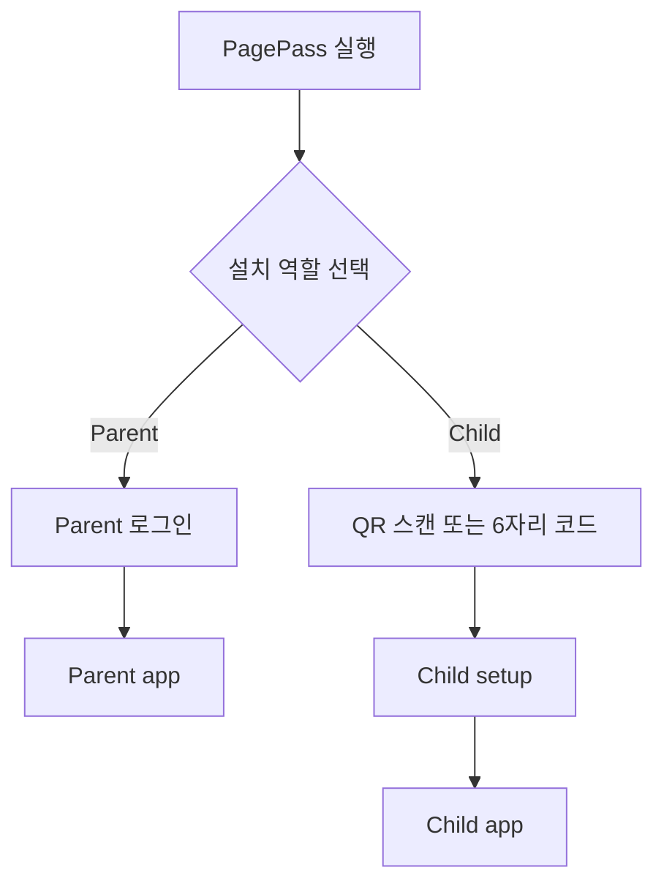
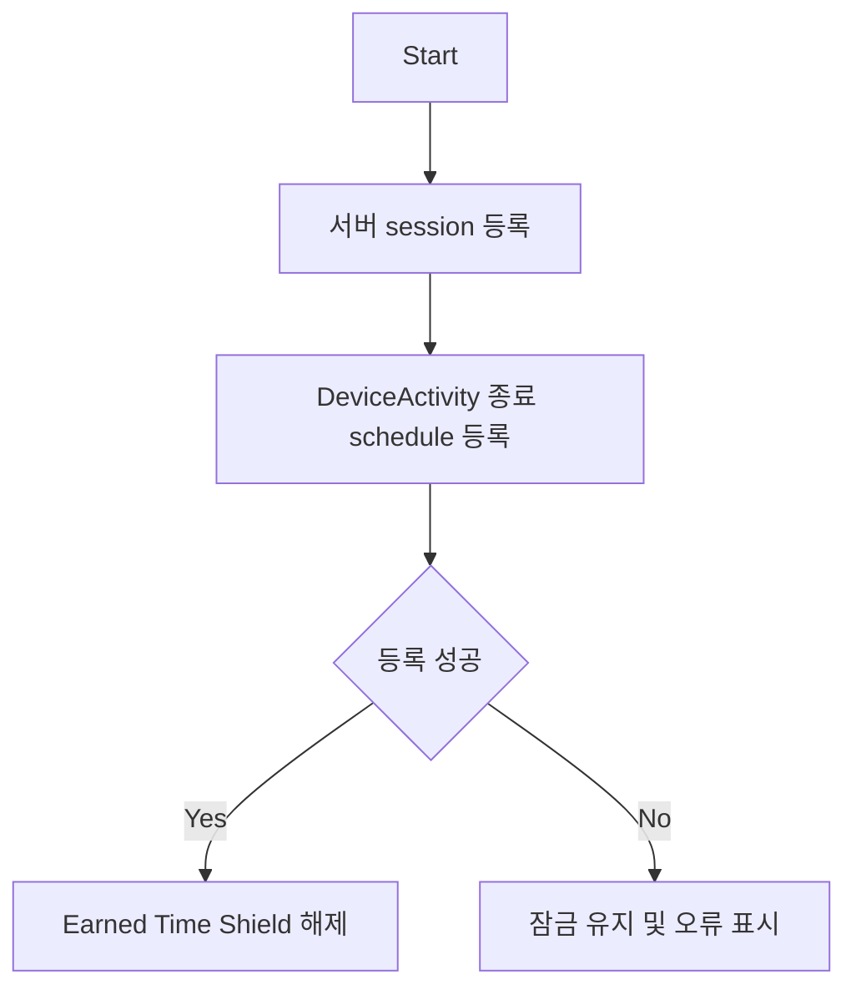
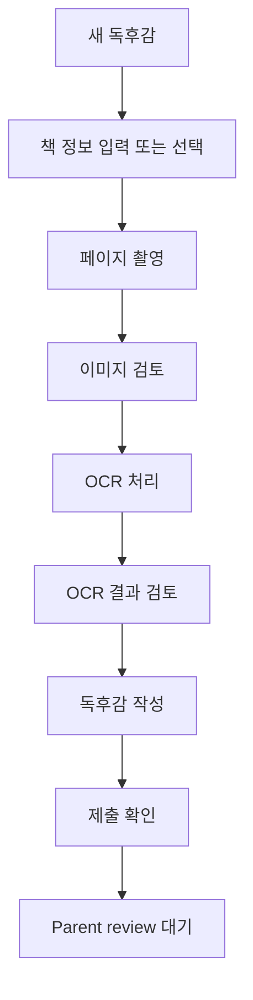
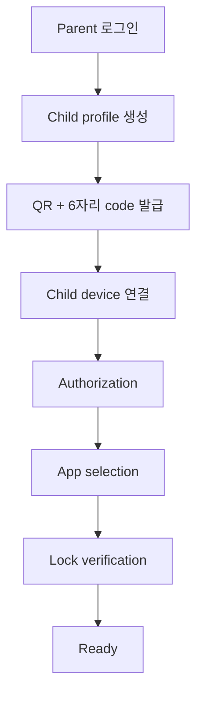
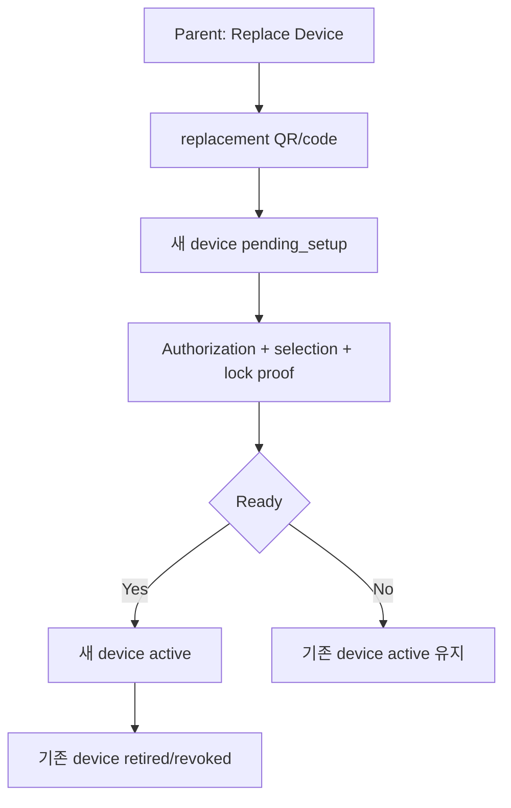

# PagePass Frontend Information Architecture

## Status

- 문서 상태: MVP frontend 기준안
- 작성일: 2026-07-17
- 대상: iOS Parent mode, iOS Child mode
- 목적: 제품 디자인, SwiftUI 구현, API 계약이 같은 화면 구조를 기준으로 작업하게 한다.

이 문서는 시각 디자인 시스템의 최종 색상이나 typography를 확정하지 않는다. 화면의 책임, 내비게이션, 상태, 사용자 흐름과 필요한 데이터가 기준 범위다.

## Product Model

PagePass는 하나의 iOS 앱이 설치 역할에 따라 Parent mode 또는 Child mode로 동작한다.



핵심 권한 경계:

- Parent는 PagePass 계정으로 로그인하고 family와 child profile을 관리한다.
- Child는 이메일이나 비밀번호로 로그인하지 않는다.
- Child installation은 부모가 발급한 일회성 QR 또는 숫자 코드로 기존 child profile에 연결된다.
- Family Controls authorization과 실제 Shield 적용은 child device에서만 수행한다.
- Earned Time 잔액과 Journal은 device가 아니라 child profile에 귀속한다.

## Shared Navigation

두 역할 모두 `Home`, `Journal`, `More`를 같은 의미와 위치로 사용한다. 역할별 핵심 행동만 두 번째 탭에서 다르다.

```text
Parent: Home | Requests | Journal | More
Child:  Home | Earn     | Journal | More
```

권장 SF Symbols:

| Tab | Symbol |
| --- | --- |
| Home | `house` / `house.fill` |
| Requests | `tray.full` / `tray.full.fill` |
| Earn | `book.badge.plus` / `book.badge.plus.fill` |
| Journal | `books.vertical` / `books.vertical.fill` |
| More | `ellipsis.circle` / `ellipsis.circle.fill` |

내비게이션 규칙:

- 선택된 tab은 역할별로 유지한다.
- Push notification은 관련 detail로 deep link한다.
- 중요한 setup 오류는 `More`에만 숨기지 않고 `Home`에도 action banner로 노출한다.
- `Requests`에만 처리 대기 건수 badge를 표시한다.
- Journal의 새 승인 결과는 일시적인 dot 또는 Home update로 알리되 지속 badge로 만들지 않는다.

## Entry And Role Selection

### Role Selection

앱을 처음 실행한 설치에서만 표시한다.

```text
How will this device use PagePass?

[ Parent ]
[ Child ]
```

역할 변경은 일반 navigation에 노출하지 않는다. 잘못 선택한 경우 `More > Reset Installation`의 명시적인 확인 흐름을 사용한다.

### Parent Entry

`Parent` 선택 직후 로그인 화면으로 이동한다.

필수 기능:

- 로그인
- 회원가입
- 계정 복구
- privacy 및 terms 진입
- 로그인 성공 후 기존 family 복원
- family가 없으면 family 생성 및 첫 child 추가

인증 제공자는 backend/auth 설계에서 확정하되 Parent mode에는 항상 실제 로그인 session이 필요하다.

### Child Entry

`Child` 선택 직후 pairing 화면으로 이동한다.

```text
Connect to a Parent

[ Scan QR Code ]

or

[ 6-digit code ]
[ Connect ]
```

Pairing 성공 후 Home으로 바로 이동하지 않는다. Child setup을 완료해야 한다.

## Child Setup

Child setup은 다음 세 gate로 구성한다.

```text
1. Device Connected
2. Screen Time Authorized
3. Apps Selected and Locked
```

상태 값:

```text
pairing_required
authorization_required
authorization_conflict
app_selection_required
locking_verification
ready
```

### Screen Time Authorization

Pairing 성공 직후 `requestAuthorization(for: .child)`를 요청한다.

결과별 화면:

| Result | UI behavior |
| --- | --- |
| Approved | app selection으로 진행 |
| Authorization canceled | 이유를 표시하고 `Try Again` 제공 |
| Invalid child account | child iCloud/Family Sharing 확인 안내 |
| Network error | 연결 확인 및 retry |
| Authorization conflict | 기존 Screen Time control app 비활성화 안내 |
| Restricted/unavailable | 복구 안내와 parent notification 제공 |

### Authorization Conflict

iOS는 다른 authorized app이 parental controls를 제공하면 PagePass authorization을 거절할 수 있다. PagePass는 충돌 앱의 이름을 알 수 없다.

```text
Screen Time Is Already Managed

Another parental-control app is currently managing this device.
Disable its Screen Time access before continuing with PagePass.

[ Open Settings ]
[ Try Again ]
[ Notify Parent ]
```

공개 API로 다른 앱의 Screen Time 세부 항목까지 직접 deep link할 수 있다고 가정하지 않는다. 비공개 `App-Prefs:` URL scheme은 사용하지 않는다. 설정 이동 경로를 화면에 표시하고 PagePass 복귀 후 사용자가 `Try Again`을 누르게 한다.

Conflict가 발생해도 device pairing은 유지한다. Parent Home에는 다음 상태를 표시한다.

```text
Device connected
Action required: Screen Time authorization
```

### Initial App Selection

Authorization 성공 후 child device의 `FamilyActivityPicker`로 관리 대상 앱을 선택한다.

MVP 기본 원칙:

- Child picker가 앱 token의 최초 출처다.
- 부모 기기의 전체 child app 목록 조회 성공에 의존하지 않는다.
- 선택한 앱은 parent decision 전까지 fail closed 상태로 둔다.
- 초기 Shield 적용과 readback 검증이 성공해야 setup을 `ready`로 전환한다.

## Child App

### Child Home

Child가 매일 사용하는 control surface다.

공통 표시:

- 정확한 Earned Time 잔액
- 현재 control 상태
- active session countdown
- 마지막 sync 상태
- 최근 Parent decision 또는 Journal update
- setup/authorization 오류 banner

상태별 화면:

| State | Primary content | Primary action |
| --- | --- | --- |
| No credit | 잔액과 부족 시간 | Earn으로 이동 |
| Below minimum | 15분까지 필요한 시간 | Earn으로 이동 |
| Ready | 잔액과 잠금 상태 | Use Earned Time |
| Active | 초 단위 countdown, 종료 시각 | Stop & Lock |
| Ending | 즉시 재잠금 상태 | action disabled |
| Sync pending | 로컬 정산 완료, 서버 대기 | Retry Sync |
| Authorization required | 보호가 비활성화된 이유 | Continue Setup |
| Setup incomplete | 남은 setup gate | Continue Setup |

Home quick links:

- `Earn Time`
- `Request an App`
- 최근 Journal 결과
- device action banner

### Use Earned Time

`Use Earned Time`은 Home에서 bottom sheet로 연다.

```text
Use Earned Time

15 min
30 min
1 hour
Max · 29m 10s

Unlocks
3 Earned Time apps

Ends at             4:32 PM
Balance afterward   14m 10s

[ Start 15 Minutes ]
```

규칙:

- 최소 session은 검증된 15분이다.
- 잔액보다 큰 preset은 disabled다.
- `Max`는 현재 사용 가능한 전체 잔액을 명시적으로 선택한다.
- 선택하지 않는다는 별도 옵션은 없다.
- 항상 wall-clock time을 차감한다. 특정 앱의 foreground 사용시간을 계산하지 않는다.
- Earned Time app 전체를 함께 해제한다.
- Always Allowed app은 session과 무관하게 사용할 수 있다.
- Blocked app은 session 중에도 잠긴다.

시작 순서:



### Active Session

Home의 Earned Time 영역이 active state로 변한다.

```text
Earned Time Active

14:27
Ends at 4:32 PM

3 apps available

[ Stop & Lock ]
```

규칙:

- app이 background 또는 suspended 상태여도 countdown은 wall clock 기준으로 계속 흐른다.
- pause는 제공하지 않는다. `Stop` 후 새 session을 시작한다.
- session 중 Parent가 시간을 추가해도 현재 session 종료 시각은 자동 연장하지 않는다.
- 새 credit은 다음 session에 사용할 수 있다.

### Stop Earned Time

실수로 종료하지 않도록 확인 sheet를 사용한다.

```text
Stop Earned Time?

Used             10m 12s
Remaining credit 18m 58s

[ Stop & Lock ]
[ Keep Using ]
```

확정 순서:

1. Earned Time apps 즉시 재잠금
2. 기존 schedule 취소
3. 경과시간 정산 생성
4. 로컬 잔액 반영
5. 서버 sync

네트워크 오류가 발생해도 잠금은 유지하고 settlement를 재시도한다. 자동 만료도 같은 결과를 만들며, app이 열려 있지 않아도 DeviceActivity callback이 재잠금을 적용한다.

### Child Earn

새 독서 활동과 OCR 제출을 만드는 탭이다.

화면 구성:

- 새 독후감 시작
- 진행 중 draft 계속하기
- OCR processing 상태
- changes requested 항목
- 최근 획득 시간

새 submission 흐름:



OCR은 필수지만 AI 평가는 보조 기능이다. Parent가 최종 승인과 reward를 결정한다.

Draft는 가능한 빨리 child profile의 cloud draft로 저장해 device 교체 시 복구할 수 있게 한다. 이미지 upload 실패와 OCR 실패는 독후감 작성 내용을 잃게 만들면 안 된다.

### Child Journal

자녀가 작성한 모든 독후감을 최신순 list로 보여준다.

Bottom navigation label은 `Journal`을 사용한다.

List item:

- 책 표지 또는 page thumbnail
- 책 제목
- 독후감 일부
- 작성/제출 날짜
- status
- 획득 시간

필터:

```text
All | Drafts | Pending | Completed
```

상태:

```text
Draft
Processing
Pending
Changes Requested
Approved
Rejected
```

### Child Journal Detail

섹션:

- Book: title, author, cover
- My Report: child-written report
- Reading Evidence: captured pages and OCR text
- Parent Review: status, comment, reward
- Timeline: created, submitted, reviewed dates

상태별 action:

| State | Actions |
| --- | --- |
| Draft | Continue, Delete, Submit |
| Processing | Retry failed processing |
| Pending | Read only |
| Changes Requested | Edit and Resubmit |
| Approved | Read only, view earned credit |
| Rejected | View reason, create revised submission |

### Child App Request

진입점:

- Home의 `Request an App`
- `More > Apps`
- Shield에서 PagePass request flow로 가능한 범위의 연결

흐름:

1. Child device picker에서 앱 선택
2. 선택한 app token과 optional message 저장
3. Parent에게 request 전송
4. Pending 동안 잠금 유지
5. Parent decision sync

Parent decision:

```text
Earned Time
Always Allowed
Blocked
Rejected
```

동일 앱에 unresolved request가 있으면 중복 request를 만들지 않는다.

### Child More

```text
Apps
- Request an App
- My App Access
- Pending Requests

Device
- Screen Time Status
- Parent Connection
- Last Sync
- Setup Status

Support
- Troubleshooting
- Privacy
- About PagePass
```

Child가 임의로 policy를 느슨하게 하거나 device를 unpair할 수 있는 destructive action은 Parent confirmation 없이 제공하지 않는다.

## Parent App

### Parent Home

여러 child를 한 화면에서 비교하고 빠르게 관리하는 family dashboard다.

Family summary에는 action이 필요한 경우만 표시한다.

```text
2 requests waiting
1 device needs attention
```

Child row/card:

- child name과 profile image
- exact Earned Time balance
- Locked / Active / Offline
- active session remaining time
- pending request count
- setup 또는 authorization issue
- last sync

Quick actions:

- Add Time
- View Requests
- Child Detail
- Add Child

### Add Time

Child Home 또는 Child Detail에서 sheet로 연다.

```text
Add Time for Atom

15 min
30 min
1 hour
Custom

Reason

[ Add Time ]
```

지급 operation은 전송 전에 idempotency key를 저장한다. 응답 유실 후 retry가 같은 credit을 두 번 지급하면 안 된다.

### Parent Child Detail

섹션:

- Overview
- App Access
- Journal summary
- Time History
- Device

Overview:

- balance
- current session
- recent ledger entries
- pending requests
- setup status

App Access:

```text
Earned Time Apps
Always Allowed
Blocked
Pending Requests
```

Journal summary:

```text
12 reports
3 approved this month
1 waiting for review

[ View Atom's Journal ]
```

`View Atom's Journal`은 Journal tab으로 이동하며 child filter를 Atom으로 설정한다.

Time History:

- Parent credit grant
- Reading approval reward
- Earned Time settlement
- Parent adjustment
- actor, reason, timestamp

Device:

- active device
- setup status
- authorization status
- app version
- last seen
- Replace Device
- Revoke Device

### Parent Requests

Parent decision이 필요한 통합 inbox다.

```text
Pending | History
All | Reading | Apps
All Children | Atom | Brian
```

Pending badge는 unresolved request 총합이다.

Reading request item:

- child
- book title/cover
- submitted timestamp
- status

Reading actions:

- Approve
- Request Changes
- Reject

Approval 시 reward sheet를 표시한다.

```text
15 min
30 min
45 min
Custom
```

Reading approval과 credit grant는 하나의 idempotent server operation이어야 한다.

App request item:

- child
- app label/icon rendered from token where available
- child message
- request timestamp
- existing policy

App actions:

- Earned Time
- Always Allowed
- Blocked
- Reject Request

### Parent Journal

모든 child의 독후감을 탐색하는 독립 tab이다.

상단 controls:

```text
All Children | specific child
All | Pending | Approved | Changes
Search by book title
```

기본 정렬은 최근 작성순이다.

List item:

- cover/thumbnail
- book title
- child name
- status
- reward
- date

Requests와 Journal의 책임:

```text
Requests = 지금 처리해야 하는 일
Journal  = 가족의 전체 독서 기록
```

새 submission은 Requests와 Journal에 동시에 나타난다. 승인 후 Requests Pending에서는 사라지지만 Journal에는 Approved로 계속 보존된다.

### Parent Journal Detail

Child Journal과 같은 submission을 Parent 관점으로 렌더링한다.

섹션:

- Book
- Reading Evidence
- OCR Text
- Child Report
- Review History
- Reward
- Timeline

Pending이면 bottom action bar를 표시한다.

```text
[ Request Changes ] [ Approve ]
```

처리 완료 상태는 actor, comment, reward와 timestamp를 포함한 read-only history로 표시한다.

### Parent More

```text
Family
- Manage Children
- Add Child
- Parent Members
- Devices

Preferences
- Notifications
- Default Reading Rewards
- Earned Time Settings
- App Request Settings

Account
- Profile
- Subscription
- Privacy
- Sign Out

Support
- Troubleshooting
- Contact Support
- About PagePass
```

Child profile 삭제보다 `Archive Child`를 우선한다. ledger와 Journal을 실수로 삭제하지 않게 한다.

## Device Pairing And Replacement

### Add Child



QR와 6자리 code는 같은 short-lived, one-time pairing session을 나타낸다.

### Replace Child Device

Child profile과 device binding을 분리한다. MVP는 child당 active device 하나를 유지하되 과거 device record와 replacement flow는 지원한다.

보존되는 데이터:

- child profile
- balance와 immutable ledger
- Journal과 images/OCR results
- Parent review history
- app request/decision history
- family preferences

새 device에서 다시 설정하는 데이터:

- Family Controls authorization
- FamilyActivityPicker selection과 app tokens
- local Shield policy
- DeviceActivity schedules
- APNs token
- Keychain device credential

FamilyActivitySelection token은 opaque하고 authorization revoke 시 무효화될 수 있으므로 새 device에 그대로 복사하지 않는다.

Replacement는 2단계다.



활성 session은 device 사이에 이전하지 않는다. 기존 device가 online이면 종료 및 sync 후 교체한다. 기존 device를 잃은 경우 server의 session start record를 기준으로 replacement commit 시점까지 정산한다.

## Notifications And Deep Links

Parent notifications:

- 새 reading submission
- changes requested resubmission
- app request
- authorization conflict/revoked
- child device setup incomplete
- child device offline
- optional Earned Time session ended

Child notifications:

- reading approved
- changes requested
- reading rejected
- app request decision
- credit added
- session expiration warning

Deep link targets:

| Event | Target |
| --- | --- |
| Reading request | Parent Journal Detail with actions |
| Reading decision | Child Journal Detail |
| App request | Parent App Request Detail |
| App decision | Child App Access Detail |
| Setup issue | role-specific Device Status |
| Credit grant | Child Home |

Push는 sync를 촉진하고 사용자를 올바른 detail로 이동시킨다. child re-lock의 correctness를 push delivery에 의존하지 않는다.

## Shared Screen States

모든 network-backed list/detail은 다음 상태를 설계한다.

- Loading
- Loaded
- Empty
- Offline with cached data
- Retryable error
- Permission/action required
- Sync pending
- Removed or no longer accessible

오류 메시지는 framework error를 그대로 노출하지 않는다. 사용자가 해야 할 다음 행동을 중심으로 표시한다.

예시:

```text
Screen Time authorization is required
[ Continue Setup ]

This update will sync when the device is online
[ Retry ]
```

## Screen Inventory

### Shared And Entry

1. Role Selection
2. Parent Login/Signup
3. Child Pairing
4. Child Setup Progress
5. Authorization Conflict Recovery

### Child

1. Home: No Credit
2. Home: Ready
3. Home: Active Session
4. Home: Sync Pending/Error
5. Use Earned Time Sheet
6. Stop Confirmation Sheet
7. Earn Landing
8. Capture Pages
9. Image Review
10. OCR Review
11. Report Editor
12. Submission Confirmation
13. Journal List
14. Journal Detail
15. App Request Picker/Confirmation
16. My App Access
17. Device Status
18. More

### Parent

1. Home / Family Dashboard
2. Add Child
3. Pairing QR/Code
4. Add Time Sheet
5. Child Detail
6. App Access
7. Time History
8. Device Detail/Replacement
9. Requests List
10. Reading Request Detail
11. Reward Approval Sheet
12. App Request Detail
13. Journal List
14. Journal Detail
15. Manage Children
16. Parent Members
17. Notifications
18. Account/Subscription
19. More

## Backend Data Needed By Frontend

구체적인 resource, endpoint, state transition과 authorization 경계는
[`api-design.md`](api-design.md)를 기준으로 한다.

주요 화면 aggregate:

### Parent Home

```text
family
children[]
child.balanceSeconds
child.sessionStatus
child.deviceStatus
child.setupStatus
child.pendingRequestCount
child.lastSyncedAt
```

### Child Home

```text
childProfile
canonicalBalanceSeconds
activeSession
policySummary
setupStatus
pendingSettlementCount
lastSyncedAt
latestUpdate
```

### Journal

```text
submissionId
childProfileId
book metadata
cover/thumbnail
report excerpt/body
status
rewardSeconds
review comment/actor
created/submitted/reviewed timestamps
```

### Requests

```text
requestId
requestType
childProfileId
status
submittedAt
display summary
decision options
decision history
```

API는 Parent가 child scope 밖의 데이터를 보거나 Child credential이 다른 child data를 요청할 수 없게 강제한다. UI filter는 authorization boundary가 아니다.

## Visual Theme

PagePass의 브랜드 primary color는 deep evergreen/teal을 사용한다. PagePass가 처벌이나 차단 중심의 앱이 아니라 독서와 활동을 통해 시간을 얻는 서비스로 느껴져야 한다.

```text
PagePass Green: #176B5B
```

Green은 성장과 신뢰를 전달하고 Parent와 Child 양쪽에서 사용할 수 있다. Red는 브랜드색으로 사용하지 않고 실제 오류 또는 destructive action에만 제한한다. Purple, dark navy 또는 단일 green 계열만으로 화면 전체를 채우지 않는다.

### Light Theme Tokens

| Token | Value | Usage |
| --- | --- | --- |
| Primary | `#176B5B` | 주요 button, selected navigation, brand action |
| Primary Pressed | `#0F5145` | pressed/active primary control |
| Primary Soft | `#DDEFE9` | selected row, subtle status background |
| Reward Yellow | `#F2B84B` | Earned Time, reward, progress highlight |
| Action Coral | `#E66A5A` | Stop과 주의가 필요한 action |
| Background | `#F6F8F7` | app background |
| Surface | `#FFFFFF` | list, sheet, modal surface |
| Primary Text | `#18211E` | title, body, primary value |
| Secondary Text | `#65716C` | metadata, timestamp, supporting value |
| Border | `#D8E0DC` | divider와 control boundary |
| Success | `#2D7D5D` | approved, connected, completed |
| Warning | `#C47A16` | pending action, changes requested |
| Error | `#C84949` | failed, revoked, destructive confirmation |
| Info | `#3776A8` | sync, neutral informational state |

### Semantic Usage

```text
Primary Green
- 주요 CTA
- selected tab
- connection/ready state

Reward Yellow
- Earned Time balance highlight
- +30 min reward
- active session progress

Action Coral
- Stop & Lock
- attention action that is not an error

Info Blue
- sync
- device information
- neutral setup guidance

Error Red
- authorization revoked
- unrecoverable failure
- destructive action
```

`Locked`는 기본 control 상태이므로 red error로 표시하지 않는다. Neutral text와 lock icon을 사용한다.

```text
Locked            Neutral gray
Active            Primary Green
Pending           Reward Yellow / Warning
Approved          Success Green
Changes Requested Warning Orange
Rejected          Error Red
Syncing           Info Blue
```

### Earned Time Presentation

Earned Time은 Green과 Reward Yellow를 함께 사용한다.

- balance의 핵심 숫자는 Primary Text 또는 Primary Green을 사용한다.
- reward 증가량은 Reward Yellow icon/highlight와 `+30 min` text로 표시한다.
- active countdown은 높은 대비의 Primary Text를 유지한다.
- progress indicator에 Reward Yellow를 사용할 수 있다.
- `Stop & Lock`은 Action Coral을 사용한다.
- Yellow는 text 대비가 낮을 수 있으므로 작은 text의 단독 background color로 사용하지 않는다.

### Parent And Child Tone

Parent와 Child는 같은 brand palette를 사용하고 별도 제품처럼 분리하지 않는다.

Parent mode:

- white/neutral surface 비중을 높인다.
- Green을 주요 action과 selected state에 제한한다.
- 여러 child와 request를 빠르게 비교할 수 있는 차분한 운영 화면으로 만든다.

Child mode:

- 같은 Green을 사용한다.
- Earn과 Journal에서 Reward Yellow와 책 표지 이미지를 더 적극적으로 사용한다.
- Home의 balance와 active session이 첫 시각적 초점이 된다.
- 장식보다 현재 상태와 다음 행동을 명확하게 보여준다.

### Dark Theme Tokens

| Token | Value |
| --- | --- |
| Background | `#101512` |
| Surface | `#19211D` |
| Primary | `#5DBA9F` |
| Reward Yellow | `#F3C568` |
| Primary Text | `#F2F6F4` |
| Secondary Text | `#A7B3AD` |
| Border | `#334039` |

Dark mode에서는 light theme color를 단순 반전하지 않는다. Primary Green과 Reward Yellow의 명도를 높이고 채도를 조절해 눈부심을 줄인다.

### Accessibility Rules

- text와 icon은 색상만으로 상태를 전달하지 않는다. label 또는 symbol을 함께 사용한다.
- body text와 background는 WCAG AA 수준의 대비를 목표로 한다.
- Yellow 또는 Coral surface 위의 text 대비를 실제 device에서 검증한다.
- Increase Contrast와 Differentiate Without Color 설정을 지원한다.
- selected tab, pending request와 error에는 shape/icon 차이를 함께 제공한다.
- Dynamic Type에서 balance, countdown, button label이 잘리거나 겹치지 않게 한다.

### App Icon Direction

App icon은 다음 조합을 기본 방향으로 한다.

```text
Deep Green background
+ Warm Yellow page/pass symbol
+ White detail where required
```

책, 시계, 자물쇠를 각각 나열하지 않는다. 책장 또는 page가 열리며 통과하는 하나의 단순한 형태로 `reading`, `time`, `pass`를 암시한다. 작은 크기에서도 식별되는 bitmap icon으로 최종 검증한다.

## Design Priorities

디자인 작업 우선순위:

1. Child Home의 `Ready`, `Active`, `No Credit`, `Authorization Required`
2. Parent Home과 multi-child 비교
3. Child Earned Time start/stop sheets
4. Parent Requests와 Reading Detail
5. 양쪽 Journal List/Detail
6. Child pairing 및 authorization recovery
7. Parent Child Detail과 device replacement
8. OCR capture/review/editor
9. More와 account/settings
10. 모든 empty/offline/error/sync states

## MVP Boundaries

포함:

- Parent login
- multiple child profiles
- one active iPhone per child profile
- QR와 6자리 pairing
- Screen Time authorization recovery
- child-selected app requests
- manual wall-clock Earned Time sessions
- OCR reading submission
- Parent approval and reward
- Parent/Child Journal
- child device replacement

초기 MVP에서 제외 또는 후순위:

- Android
- web dashboard
- AI auto-approval
- simultaneous multiple active devices for one child
- social/competition features
- full-device lock
- private Settings URL schemes

## Open Product Decisions

구현 전에 별도로 확정할 항목:

- Parent authentication provider와 account recovery 방식
- 기본 reading reward preset
- Pending submission 취소 허용 여부
- Rejected report를 수정할지 새 submission으로 만들지
- Parent member roles를 MVP에 포함할지
- custom Shield copy와 Shield action 범위
- session expiration warning 시점
- subscription/paywall 진입 위치

## Apple Framework References

- [Family Controls](https://developer.apple.com/documentation/familycontrols)
- [FamilyControlsError.authorizationConflict](https://developer.apple.com/documentation/familycontrols/familycontrolserror/authorizationconflict)
- [FamilyActivitySelection](https://developer.apple.com/documentation/familycontrols/familyactivityselection)
- [Managed Settings](https://developer.apple.com/documentation/managedsettings)
- [Device Activity](https://developer.apple.com/documentation/deviceactivity)
